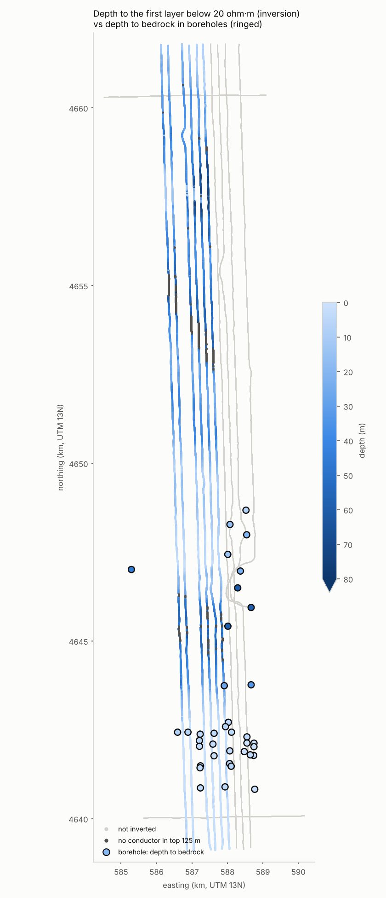
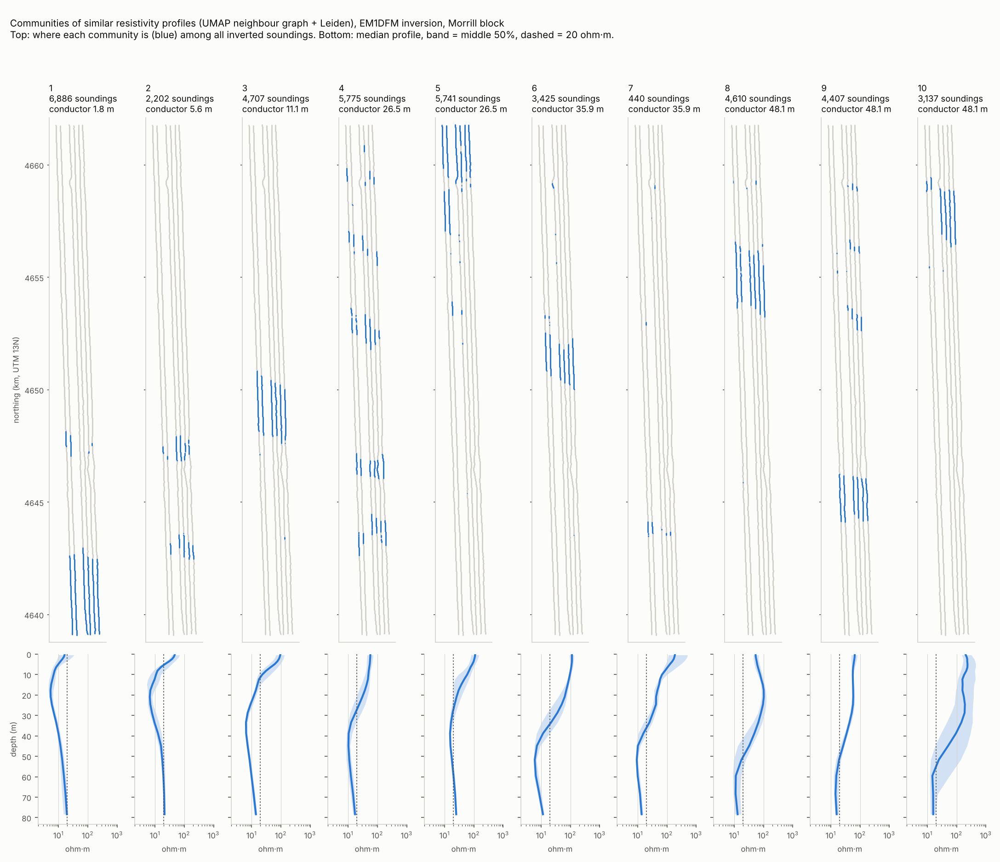

# 03 · The airborne survey, the inversion, and communities

## What the helicopter measured

Each sounding records 12 numbers: the **in-phase** and **quadrature** parts
of the secondary magnetic field at six frequencies, in parts per million (ppm)
of the primary field.
- **In-phase** is the part in step with the transmitter. It grows over good
  conductors.
- **Quadrature** lags a quarter cycle behind. It dominates over moderate
  conductors.
- **Frequency sets depth:** low frequencies penetrate deeper, high frequencies
  see the near surface.

The response also depends strongly on how high the sensor (the "bird") is
flying, because the field weakens rapidly with distance. That's why raw
channels are a poor input for clustering. On line 30050, UMAP on raw channels
produced a cluster made of nothing but a high-flying stretch (median 52 m vs
35 m overall). An inversion models the bird height explicitly, so its
resistivities are largely free of that effect: UMAP axes correlate with bird
height at |ρ| ≤ 0.29 on inverted profiles, versus 0.48 on raw channels. Only
1.3% of soundings were flown above 60 m.

The survey file also carries:
- `powerline_monitor`: high values flag interference from power lines;
- `mag_nt`: magnetics.

## Two kinds of height

The survey's heights are above the **ellipsoid**, a smooth mathematical
surface. The boreholes' collars are above **sea level** (the geoid). Here the
two differ by about 15 m. The build estimates the offset from 30 boreholes
that sit within 100 m of a sounding: **14.54 m**, with a median absolute
deviation of 0.89 m. It stores both heights. This matters in Step 3, where
model layers, borehole depths and water levels must share one datum.

## The inversion

`inv_model_pt1.csv` is a deterministic 1D inversion (UBC EM1DFM):
- **Coverage:** the first six flight lines, 41,330 of the 71,470 soundings.
  Lines L30070–L30100 and the tie lines were never inverted.
- **Layering:** 24 layers over a half-space, down to 125 m.
- **Implausible values:** 0.35% fall outside 1–1,000 ohm·m (as low as 0, as
  high as 3 million). The `model_resistivity_clean` view flags them.

**Checked against the boreholes** (`borehole_vs_model`): only 7 logged holes
are within 100 m of an inverted sounding.
- Across those holes (82 hole-layers), the rank correlation between log and
  inversion is **0.65**, and **0.75–0.89 in layers 5–9** (about 3–13 m deep).
- The inversion reads about 25% more resistive than the logs.
- With at most 7 holes per layer, treat these numbers as indicative only.

## Depth to the conductor: the base of the aquifer

In this valley the strongest contrast is sandy sediment over conductive
bedrock (note 01). The view `model_conductor_depth` gives, for every
inverted sounding, the top of the first layer below 20 ohm·m, skipping the
top 1.8 m so that a conductive soil doesn't count. Against the borehole
bedrock depths:

- across the 17 holes within 250 m, it is within **1.8 m** of the logged
  bedrock depth (median);
- at 2-L-96, bedrock (Chadron) is at 26.2 m in the hole and 26.5 m in the
  inversion;
- across the block it ranges from about 2 m in the south to over 55 m in
  the north (10th–90th percentile 1.8–55 m).

For hydrology this is the most useful single map so far. Saturated thickness
is roughly bedrock depth minus water-table depth. Transmissivity, the
quantity a groundwater model needs, is K × saturated thickness.

The borehole cluster with deep bedrock (dark rings, about 588.0–588.7 km
east, 4,645–4,647 km north) is the buried valley from note 02. It sits just
**east of the inverted lines**. Inverting lines L30070–L30100 is the way to
see it in the airborne data.

## Communities of similar profiles (UMAP + Leiden)

**The question:** which soundings have similar resistivity-depth profiles,
and do those groups mean anything geologically?

**Method:**
1. Each sounding's profile: log₁₀ resistivity in layers 1–21 (top 84 m),
   clipped to 1–1,000 ohm·m.
2. UMAP builds a weighted **nearest-neighbour graph**: each sounding is linked
   to the 30 whose profiles are most alike.
3. **Leiden** finds communities in that graph by modularity.
4. Communities are numbered by their median depth to the conductor.
5. The 2-D UMAP picture is used only for display.

**Why not cluster the UMAP picture?** I tried that first:

| Method | Groups | Seed-to-seed agreement (ARI) | Unassigned |
|---|---|---|---|
| HDBSCAN on UMAP, small clusters | 44–46 | 0.66–0.73 | 15–19% |
| HDBSCAN on UMAP, large clusters | 6 | 0.62–0.76 | 19% |
| **Leiden on UMAP's graph** | **10** | **0.72–0.79** | **0%** |

The profiles form a continuum, mostly in how deep the sandy layer goes, and
density clustering cuts a continuum at arbitrary points. Community detection
on the graph was the most reproducible, and it gave the longest unbroken
stretches along the flight lines. It is also the similarity network from
note 02: the small-world measures can be computed on this same graph.

What the communities show:

- **They are spatially coherent.** Community 1's 6,886 soundings fall in 10
  unbroken stretches.
- **They form north–south zones that cut across all six lines:** shallow
  conductor in the south (1–2), deep in the north (8–10).
- **They agree with the boreholes:**
  - community 1 (conductor ≈ 1.8 m): seven K-94 holes with Brule at
    1.5–6.2 m;
  - community 2 (≈ 5.6 m): 1-K-94 and 2-T-99 at 5.5–5.8 m;
  - community 4 (≈ 26.5 m): 2-L-96 at 26.2 m.
- **Communities with the same conductor depth differ in the sediments above
  it.** For example, 4 vs 5 (55 vs 91 ohm·m in the top 10 m) and 8–10 (60 to
  221 ohm·m). That is where texture differences inside the aquifer, sandier
  or siltier, would show up.

Run it yourself: `uv sync --extra analysis`, `uv run morrill build`, then
`uv run morrill communities`. It takes about 3 minutes (three seeds) and
writes `data/derived/communities.parquet` and the two figures.

## Questions to think about

1. Communities 4 and 5 share a conductor depth but differ in shallow
   resistivity. Which borehole data could tell you whether that difference is
   grain size or water quality?
2. Seed-to-seed agreement is 0.72–0.79, not 1. Where on the map would you
   expect the disagreements, and why might that be fine?
3. If the communities are mostly "depth to bedrock" in disguise, is a
   continuous map of that depth more useful than 10 classes? When would you
   still want classes?
