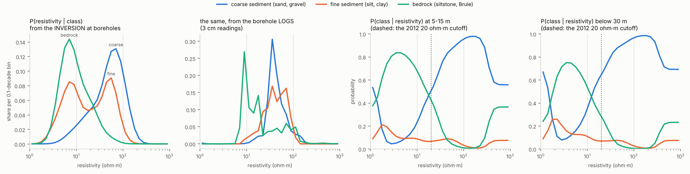
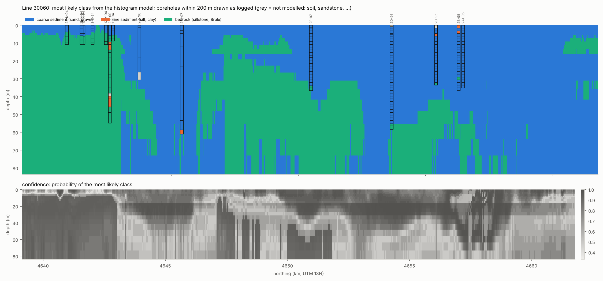

# 04 · Rock class from resistivity: the histogram model

Resistivity is not what a groundwater model needs. It needs rock type, and from
that, hydraulic conductivity. The oldest honest way to translate one into the
other is Bayes' rule with histograms:

```
P(class | resistivity, depth)  ∝  P(resistivity | class)  ×  P(class | depth)
        posterior                     likelihood                prior
```

- **Likelihood:** for each class, a histogram of the resistivities seen where
  boreholes say that class is present.
- **Prior:** how common each class is at that depth, before looking at
  resistivity.
- **Posterior:** their product, normalised. It gives a probability of each
  class in every model cell, not just a label.

Code: `src/morrill/analysis/lithology.py`. Run with `uv run morrill lithology`.

## Classes and training data

The 39 driller's labels are grouped into three classes that matter for flow:

| Class | From texture | Logged metres used |
|---|---|---|
| coarse sediment | sand, sand and gravel, gravel, silty sand | 440 |
| fine sediment | silt, clay | 53 |
| bedrock | mudrock (siltstone, claystone, Brule, shale) | 156 |

Training uses the **30 boreholes within 200 m of an inverted sounding**. For
each of the top 21 model layers (0–84 m), the training row records how many
metres of each class the driller logged inside that layer. These are *soft
labels*: a layer that's half sand and half clay counts half to each.

Why histograms of the **inversion's** resistivity, and not the borehole logs?
Because the model will be applied to inversion values, and the two disagree in
scale. The first two panels below show it:



- **In the logs** (3 cm readings), bedrock sits at about 9–20 ohm·m, while
  sand and clay both sit at 20–100 ohm·m.
- **In the inversion**, bedrock moves down to about 5–10 ohm·m, sand up to
  50–80 ohm·m, and **fine sediment has two peaks**, one like bedrock and one
  like sand. The inversion's smooth layers can't resolve thin silt and clay
  beds, so they take on the resistivity of whatever surrounds them.

## Two extra pieces of knowledge

1. **Depth prior.** Bedrock becomes more common with depth. The prior is
   estimated in four depth bands (0–5, 5–15, 15–30, 30+ m). Each band is
   pulled toward the overall prior, so bands with little data don't swing
   wildly.
2. **Superposition: sediment lies on bedrock.** Only 3 of the 90 holes that
   reach bedrock log sand or gravel beneath it (21 m in all). So once a
   profile's posterior gives bedrock at least 0.7, the layers below use a
   "below bedrock" prior learned from the boreholes. It is soft: a strongly
   sand-like resistivity can still win. Without it, the model turned the deep,
   poorly resolved layers under the Brule back into "sand".

The histograms are lightly smoothed, and 1% of each likelihood is spread
evenly over all bins. So a resistivity never seen in training (e.g. above
400 ohm·m) falls back to the prior instead of producing nonsense.

## How well does it work?

Each borehole is predicted by a model fitted on the other 29 (leave one hole
out), across 317 layers that are at least 60% one class:

| Model | Accuracy | Coarse recall | Fine recall | Bedrock recall | Log loss | Aquifer yes/no |
|---|---|---|---|---|---|---|
| Depth prior alone | 0.63 | 1.00 | 0.00 | 0.00 | 0.88 | 0.62 |
| Histogram, one prior | 0.77 | 0.88 | 0.00 | 0.85 | 0.69 | 0.82 |
| Histogram, depth prior | 0.78 | 0.92 | 0.00 | 0.81 | 0.65 | 0.81 |
| **+ superposition** | **0.80** | **0.92** | **0.00** | **0.88** | **0.62** | **0.83** |
| 2012 rule: aquifer if ≥ 20 ohm·m | | | | | | 0.79 |

*Log loss* scores the probabilities themselves, and lower is better: it
punishes confident mistakes.

The superposition trigger (0.7) was chosen from three values tried on these
same 30 holes, so its row is slightly flattering.

Is P(coarse) honest? Grouping layers by predicted probability:

| Predicted P(coarse) | 0.07 | 0.29 | 0.51 | 0.71 | 0.91 |
|---|---|---|---|---|---|
| Observed share of coarse metres | 0.09 | 0.39 | 0.71 | 0.74 | 0.89 |
| Layers | 68 | 50 | 24 | 25 | 162 |

Roughly calibrated at the ends. In the middle (0.3–0.5) it is a little too
pessimistic about sand.

## What it tells us

- **On "aquifer or not", it barely beats the 2012 rule** (0.83 vs 0.79). In
  fact the posteriors cross at about 13–20 ohm·m, so the model independently
  rediscovers that the 20 ohm·m cutoff was a sensible choice. Its real gains
  are **probabilities**, which a groundwater model can use to carry
  uncertainty forward, and the bedrock/sediment ordering.
- **Fine sediment is invisible.** It is never the most likely class, and its
  probability rarely exceeds 0.3. This matches note 01: in this valley
  resistivity separates sediment from bedrock, not sand from clay.
  Consequence: a conductive clay layer inside the aquifer looks like the top
  of bedrock. The section below has one candidate, at 4,647–4,650 km and
  6–15 m depth, with no borehole to check it.



Along line 30060 the model follows the boreholes well:
- the shallow Brule under the K-94 holes in the south;
- bedrock at about 34 m at 2F-97 and 55 m at 2D-96;
- 30–37 m at the 2C/2B/2A1-95 group.

The confidence panel shows where to doubt it: transitions, and depths below
about 40 m.

## Limits

- **Few boreholes:** 30, with only 53 m of fine sediment. More would come
  from inverting the four uninverted lines, which have boreholes nearby, and
  from more drilling.
- **One inversion:** the probabilities inherit its biases, and there is no
  depth-of-investigation mask. The 28-layer inversion would be an
  independent check.
- **Each sounding on its own:** apart from superposition, a sounding's
  neighbours along the line don't inform it. A spatial model (a hidden
  Markov model along lines, or the geostatistics of note 02) would.

## Toward hydraulic conductivity

With P(class) in every cell, the expected log K is a probability-weighted
mix of class values:

```
log K  ≈  Σ  P(class) × log K_class
```

Its spread across classes gives K's uncertainty. Combined with the depth to
bedrock (note 03), that is the input for the first groundwater model in
Step 3.

## Questions to think about

1. The fine class has two peaks in the inversion. What does that suggest about
   the thickness of the silt and clay beds compared with the model layers?
2. Superposition is "soft". When would you want it hard, and when could a hard
   rule mislead you here? Think of sandstone lenses in the Brule.
3. If you had to pick 10 new drilling sites to improve this model most, where
   would you put them? Look at the confidence panel and at the uninverted lines.
