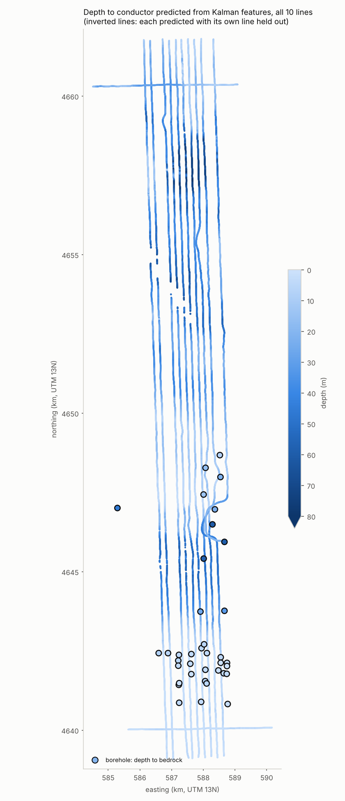

# 05 · Features along flight lines with a Kalman filter

So far every sounding has been treated on its own: the inversion fits each one
separately, and the histogram model classifies each one separately. But the
helicopter samples every 3.2 m, and the ground doesn't change much in 3 m.
The raw channels are about 98% correlated 32 m apart and still 60–87% at
320 m. A state-space model makes that continuity explicit.

## The model

```
x_t = A x_{t-1} + w_t          hidden state: 4 numbers describing the ground under sounding t
y_t = C x_t + D u_t + v_t      what the bird sees: 12 channels (log ppm, standardised)
```

- **x_t, the state:** not resistivity at given depths, but whatever 4 numbers
  best explain the 12 channels.
- **A:** how the state carries over from one sounding to the next. Close to
  the identity matrix here, because the ground changes slowly.
- **w_t, process noise (covariance Q):** how much the ground is *allowed* to
  change per step. Small Q gives smooth features; large Q lets them jump.
- **C:** how the state shows up in each channel.
- **u_t, inputs:** things we know and don't want in the state. Here that's a
  constant, log bird height, and its square. **D** is their effect, learned
  from the data. This matters because log amplitude correlates with log
  height at up to −0.90 (40 kHz quadrature). Without this term, the "geology"
  features would partly be the pilot's altitude.
- **v_t, observation noise (variances R, one per channel):** sensor noise and
  anything the 4-number state can't explain.

## The three algorithms

**Kalman filter (forward).** At each sounding:
1. *Predict* the state from the previous one: x̂ = A x, with uncertainty
   P = A P A′ + Q.
2. Compare with what was measured. The **innovation**, e = y − C x̂ − D u, is
   the surprise.
3. *Update*: move the state toward the measurement by the Kalman gain
   K = P C′ S⁻¹, where S = C P C′ + R is the innovation's expected spread.
   The gain weighs how much to trust the new sounding against the running
   estimate.

The **innovation score** e′ S⁻¹ e should follow a χ² distribution with 12
degrees of freedom if the model is right. Large values mean "this sounding
doesn't fit its neighbours": a spike, power-line noise, or a sharp
geological boundary.

**Rauch–Tung–Striebel smoother (backward).** The filter only uses soundings
*before* t. The smoother runs back along the line, so each estimate uses the
whole line, before and after. Its uncertainty is never larger than the
filter's.

**EM (Shumway & Stoffer, 1982): learning A, C, D, Q, R.**
- **E-step:** run the filter and smoother with the current parameters.
- **M-step:** re-estimate every parameter in closed form from the smoothed
  states, as linear regressions.
- **Repeat.** Each round can only increase the likelihood; the tests check
  this. All 12 lines share one set of parameters, and each line is its own
  sequence.

The filter, smoother and EM are about 150 lines of numpy in
[`src/morrill/analysis/statespace.py`](../../src/morrill/analysis/statespace.py),
written to be read.

## One subtlety: the features have no fixed "direction"

C x = (C T⁻¹)(T x) for any invertible T, so the model can't tell one set of
4 numbers from a rotated set. After fitting, the code picks a canonical
rotation: the features are uncorrelated with unit variance, their loading
columns are orthogonal and ordered by how much of the channels they explain,
and their signs are fixed. So z1 is the main mode, z2 the next, and so on.

## Gaps: when the bird flies too high

Above about 60 m the bird barely sees the ground; on line 30090 the
helicopter climbed to 139 m. Those 940 soundings (1.3%) are treated as
**missing**:
- the filter skips its update step;
- the smoother carries the state across the gap, with uncertainty growing
  toward the middle;
- EM leaves those rows out when it re-estimates C, D and R.

Missing data is one of the things Kalman models handle naturally. In the
figure below, the gap at 4,646–4,647 km shows as straight segments inside
a widening band.

## Results

From `uv run morrill kalman` (k = 4; EM stopped at its 50-iteration cap,
when the last step changed the log-likelihood by 4 × 10⁻⁵ in relative
terms).

**1. Flight height is removed from the features.** Largest |rank
correlation| with log bird height:

| Raw channels | Kalman, without the height term | Kalman features |
|---|---|---|
| 0.87 | 0.72 | **0.03** |

The smoothing alone doesn't do it; the explicit height input does. A little
height still leaks where the bird climbs steeply but stays under 60 m
(the edges of the gap above).

**2. Innovations flag noise.** Of the 1% most surprising soundings, 10% are
among the 1% with the most power-line noise (chance would be 1%). The rest
are spikes and sharp changes along the line. Before the high-flying stretches
were masked this was 16%, because some of those stretches were over power
lines.

**3. The features don't beat raw channels at copying the inversion.**
Predicting the inversion's depth to conductor, with each of the 6 inverted
lines held out in turn (39,886 soundings, gradient boosting):

| Inputs | Mean error (m) | Within 5 m | R² |
|---|---|---|---|
| Raw channels + bird height | **2.26** | 0.91 | 0.93 |
| Raw, smoothed over 31 soundings | 2.38 | 0.91 | 0.92 |
| Kalman, without the height term | 2.74 | 0.87 | 0.91 |
| Kalman features | 2.89 | 0.85 | 0.92 |

That's no surprise in hindsight. The inversion is itself a sounding-by-sounding
function of the raw channels and bird height. A flexible model given exactly
those inputs reproduces it best, and compressing 12 channels into 4 smooth
features throws away detail it uses.

**4. Out of sample, the buried valley shows up, but too shallow.** The four
lines L30070–L30100 were never inverted. At the 12 boreholes within 100 m of
them:

| Hole | Bedrock (m) | Raw: predicted | Kalman: predicted | Kalman 80% interval |
|---|---|---|---|---|
| shallow Brule holes (8) | 0.6–16.2 | within ~1–5 m | within ~1–3 m | narrow |
| 1-G-96 (Chadron) | 21.9 | 10.1 | 8.2 | 10–21 |
| 2-J-97 (Pierre) | 58.5 | 44.1 | 45.2 | 40–48 |
| 1-H-97 (Pierre) | 60.3 | 37.1 | 33.3 | 30–37 |
| 1-J-96 (Pierre) | 59.7 | 37.3 | 20.2 | 14–25 |

Both kinds of input give the deepest predictions on these lines exactly where
the valley holes are, so the valley is detected. But both are 15–40 m too
shallow there. The true depth fell inside the Kalman 80% interval at **none
of the 12 holes**. Those intervals describe how well the inversion was
copied, not how wrong the inversion (or the copy) might be, so they are
overconfident.

It isn't simple extrapolation: 10% of the training soundings have a conductor
at 55 m or deeper. And raw channels fail about as badly as the features. So
the limit is in the labels or in the physics, not in the features. Two
explanations remain, and they need physics to tell apart:

- the valley's signal is ambiguous at that depth: under 40–55 m of resistive
  gravel, a deeper conductor and a weaker one can give similar responses; or
- the inversion would itself put the conductor shallower there, so a model
  trained to copy it can't do better.




## What the Kalman model is good for here

- **Height-free, along-line-coherent descriptors**, with an uncertainty for
  every sounding and sensible handling of gaps. Good inputs for clustering
  (note 03) or for a model of rock class that has no inversion to lean on.
- **Quality control:** the innovation score is a single "this doesn't fit"
  number per sounding.
- **Not** as a replacement for physics where the labels run out.

The natural next step keeps the Kalman idea and adds the physics: an
**ensemble Kalman inversion**. Instead of learning a statistical state from
the channels, it updates an ensemble of layered-earth models with a real EM
forward model, sounding by sounding along the line. Each sounding's result
becomes the next one's prior. It gives a probabilistic answer, with the depth
ambiguity visible, at a fraction of MCMC's cost, and it works on the four
uninverted lines.

## Questions to think about

1. Why does the *no-height* Kalman model still correlate 0.72 with height,
   when smoothing ought to average the pilot's ups and downs away?
2. The 80% intervals were too narrow at every valley hole. Which sources of
   uncertainty did they leave out?
3. Q (how fast the state may change) was learned, not chosen. What would a
   much smaller Q do to a sharp edge like the buried valley's wall?
