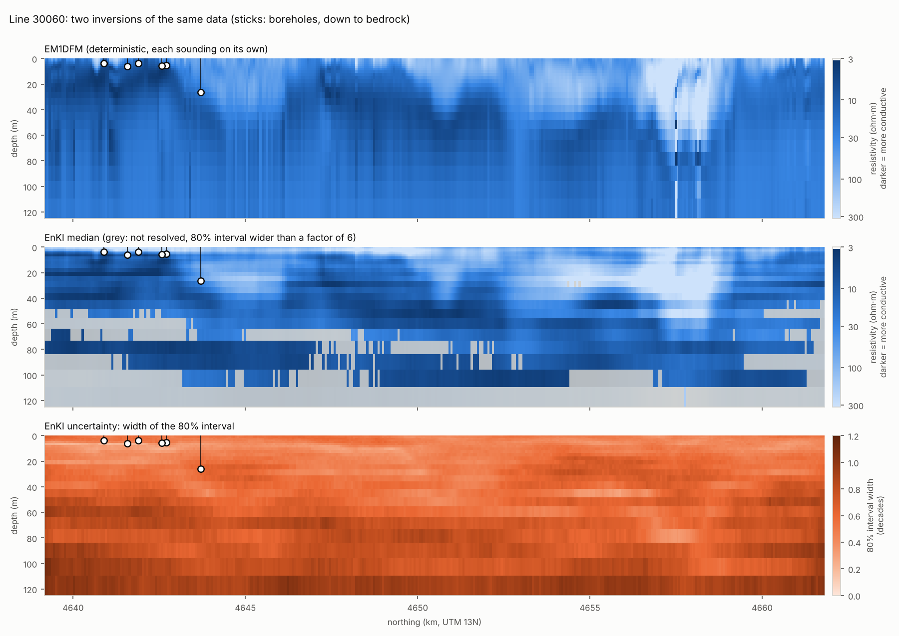
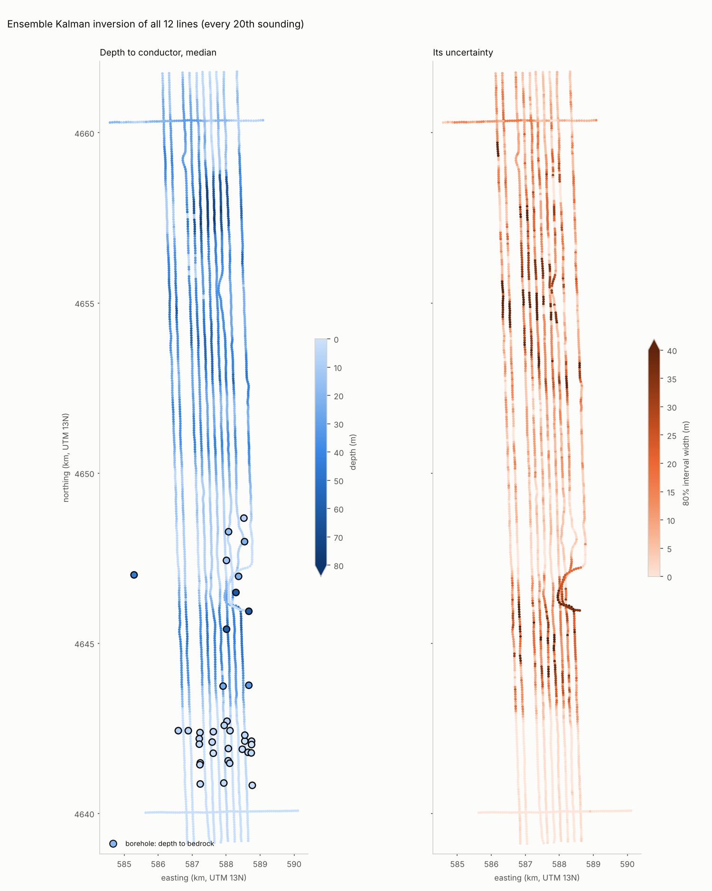

# 06 · Ensemble Kalman inversion: physics and statistics, along the line

Note 05 ended at a wall. A model trained to copy the 2012 inversion can only
be as good as that inversion, and on the four lines nobody inverted
(L30070–L30100) it put the buried valley 15–40 m too shallow, with intervals
that missed every valley hole. The way past is to stop copying and invert the
data ourselves, keeping what the Kalman idea does well: carry knowledge from
one sounding to the next along the line.

This note builds that in two parts:
- **the physics:** what the bird should measure over a given layered earth
  ([`fdem.py`](../../src/morrill/analysis/fdem.py), about 60 lines of numpy);
- **the statistics:** how an ensemble of earths is nudged, sounding by
  sounding, until it agrees with the data
  ([`enki.py`](../../src/morrill/analysis/enki.py)).

## Part 1: the physics

### What the bird measures

The transmitter coil carries an alternating current, so it acts as a magnetic
dipole. Its field (the **primary**) induces eddy currents in the ground; their
own field (the **secondary**) reaches the receiver coil 7.9 m away (9.0 m for
the coaxial pair). The system reports the secondary as a fraction of the
primary, in parts per million, split into two parts:
- **in-phase (I):** in step with the transmitter current;
- **quadrature (Q):** a quarter cycle behind it.

A good conductor responds mostly in phase; a weak one mostly in quadrature.

How deep each frequency sees is set by the **skin depth**, δ ≈ 503 √(ρ/f)
metres, the depth at which the induced field has dropped by a factor of e:

| Frequency | δ at 10 ohm·m | δ at 40 ohm·m | δ at 150 ohm·m |
|---|---|---|---|
| 378 Hz | 82 m | 164 m | 317 m |
| 1,776 Hz | 38 m | 76 m | 146 m |
| 3,345 Hz (coaxial) | 28 m | 55 m | 107 m |
| 8,171 Hz | 18 m | 35 m | 68 m |
| 41,020 Hz | 8 m | 16 m | 30 m |
| 129,550 Hz | 4 m | 9 m | 17 m |

Under resistive gravel (about 150 ohm·m) even 8 kHz reaches 60 m, so the
valley's floor of Pierre Shale should be within reach.

### From a layered earth to ppm

For flat layers, the secondary field is an integral over horizontal
wavenumber λ (Ward & Hohmann, 1988). For the coplanar coils:

```
Hs/Hp = −r³ ∫ r_TE(λ) e^(−2λh) λ² J0(λr) dλ
```

The coaxial coils have the same form, with J0 replaced by J0 − J1/(λr) and a
factor ½.
- **h** is the bird height and **r** the coil separation.
- **e^(−2λh)** is the trip down to the ground and back up. It is why height
  matters so much: the response falls roughly as 1/h³.
- **J0** is a Bessel function: the coil geometry.
- **r_TE(λ)**, the reflection coefficient, holds all the geology. It comes
  from a recursion that starts in the bottom layer and works up, one line of
  code per layer (`reflection_te`).

Two checks show the integral is right:
1. **A perfect conductor** has r_TE = −1, and the integral reduces to the
   field of a mirror-image dipole 2h below the bird. The code matches that
   exact formula to 10⁻⁵ (`test_perfect_conductor_matches_the_image_dipole`).
2. **Random layered earths** agree with slow adaptive quadrature to within
   0.01 ppm; the noise is 5–40 ppm.

The integral is computed with the plain trapezoid rule in ln λ, 6 points per
decade (24 in all). That is enough because the integrand vanishes smoothly at
both ends; it is the same idea that makes "digital filters" work in EM codes.
One numpy call evaluates an ensemble of earths at once: about 2,700 earth
models per second per core.

### Does it reproduce the 2012 inversion's data?

Running EM1DFM's own resistivity models back through `fdem.py` and comparing
with the measured data tests everything at once: the coil geometry, the sign
conventions, the units and the height.

| Channel | Predicted / measured | Correlation |
|---|---|---|
| 1,776 Hz I, Q | 1.00, 0.98 | 0.999, 0.999 |
| 400 Hz Q | 1.00 | 0.999 |
| 8,171 Hz Q; 41 kHz I, Q | 0.98; 0.98, 0.96 | ≥ 0.996 |
| 129 kHz I, Q | 1.06, 1.03 | 0.995, 0.989 |
| **400 Hz I** | **0.83** | 0.990 |
| **coaxial 3,345 Hz I, Q** | **0.87, 0.88** | 0.996 |
| **8,171 Hz I** | **1.10** | 0.999 |

Most channels agree to within 1–5%. Three are off by 10–17%, consistently,
whatever the geology. Our own inversion, a different method, misses the same
three channels by the same amount and in the same direction (below). When two
different inversions can't fit a channel in the same way, the problem is in
the data, not the inversions: most likely a calibration error on those
channels.

## Part 2: the statistics

### The unknowns and the prior

At each sounding the unknowns are

```
θ = [log10 ρ of the 24 layers and the half-space, δh]
```

The layering is the same as EM1DFM's, so results can be compared layer by
layer. δh is a correction to the laser altimeter, which can read the
treetops instead of the ground.

The **prior** says what is plausible before seeing the data. It is learned,
not invented:
- **Mean and spread** of log10 ρ come from the induction logs, averaged into
  the model layers: about 40 ohm·m, with a spread of a factor of about 2.
- **Vertical correlation** comes from the logs too:
  `corr(Δz) = c + (1 − c) · exp(−Δz / L_v)`.
  - c is the share of variation that moves a whole profile together (one
    hole simply more resistive than another).
  - L_v is how far down a local change carries.
- **Holes are held out.** The 13 log holes within 100 m of the survey are
  left out, so the prior can't leak the answers the checks use. That leaves 19.

The logs pin down the short-range shape (correlation 0.87 at 1 m, 0.67 at
3 m). They do **not** pin down c. The 13 near holes suggest about 0.7, the 19
far ones about 0. With 6–19 holes per pair of layers, a correlation carries a
standard error of about 0.25. So c is chosen from the airborne data instead
(below), with L_v refitted to the logs for each choice.

**Along the line**, θ follows an AR(1) process:

```
θ_t = m + a (θ_{t−1} − m) + w_t,    a = exp(−Δ / L_h),    w_t ~ N(0, (1 − a²) Σ)
```

It is the discrete form of a Gaussian process with correlation
exp(−distance / L_h). The factor (1 − a²) is chosen so that the distribution
at every single sounding is exactly the prior N(m, Σ) (a test checks this).
L_h only controls how far knowledge carries along the line. It is the same
kind of dynamics as note 05's A = 0.99 I.

### The update: a Kalman filter for a nonlinear problem

The Kalman filter in note 05 assumed the observations were a *linear*
function of the state. EM physics isn't linear. The **ensemble** Kalman
filter gets around that by never writing the physics down as a matrix:
1. **Represent the uncertainty by N earths** (N = 400), drawn from the
   current distribution.
2. **Run the physics on all of them.** This gives N predicted data vectors.
3. **Measure covariances from the ensemble.**
   - C_θd: how each parameter co-varies with each channel across the
     ensemble. This is the physics' sensitivity, learned by example.
   - C_dd: how the channels co-vary with each other.
4. **Move every member** by the Kalman gain:
   ```
   θ_i ← θ_i + C_θd (C_dd + α R)⁻¹ (d_obs + √α ε_i − g(θ_i))
   ```
   - R is the data error, assumed to be √(floor² + (rel · |d|)²), with the
     floors from the 2015 paper's Table 1.
   - ε_i is fresh noise per member, so the ensemble keeps an honest spread.

**ES-MDA** (Emerick & Reynolds, 2013) does step 4 four times with the data
error inflated by α = 4. Many small steps follow the curvature of the physics
better than one big one. For a linear problem the result is exactly the
Gaussian posterior (`test_es_mda_gives_the_exact_posterior_for_a_linear_problem`).

**Along the line:**
- **Forecast:** push the ensemble one step with the AR(1) above.
- **Update:** apply ES-MDA with this sounding's data.
- **Smoother:** after the last sounding, an ensemble Rauch–Tung–Striebel
  smoother runs back along the line, so every sounding uses data from both
  sides, just as in note 05.
- **The anchor test:** for linear observations, the ensemble filter and
  smoother reproduce note 05's exact Kalman smoother, gaps included
  (`test_ensemble_filter_and_smoother_match_the_exact_kalman_smoother`).

**Soundings:** every 20th one is used (about 64 m apart), roughly one
footprint, so neighbouring data aren't near-copies of each other. Where the
bird flew above 60 m, the step is forecast but not updated.

### Two modes

- **Coupled:** the along-line filter and smoother above.
- **Independent:** every sounding starts from the same prior and borrows
  nothing from its neighbours. It is a per-sounding Bayesian inversion, the
  job Burke's MCMC did.

### Why the independent mode struggles

From the broad prior, ES-MDA can't fit the data well. The median misfit stays
at 2.0–2.3, whether it gets 4, 8 or 16 passes; the coupled mode reaches about
0.9. The ensemble update is Gaussian: it can only shift and stretch a cloud of
models. From a broad start, the cloud spans models whose responses differ
nonlinearly, and the linear step can't reach the answer. The coupled mode
starts each sounding from its neighbour's answer, so each update is small and
nearly linear. **Borrowing from the neighbours is what makes the ensemble
method work at all here**, not just a way of smoothing.

### Ensemble size

Fewer members understate the uncertainty. The width of the 80% interval for
layer 12 was 0.40 decades with 100 members, 0.45 with 200 and 0.54 with 400.
The final runs use 400. The search over settings uses 100, where only the
ranking matters.

### Choosing the settings: the marginal likelihood

Several settings are not knowable in advance:
- the along-line correlation length L_h;
- how much to widen the logs' spread;
- the whole-profile share c;
- the data error.

They are chosen the same way EM chose note 05's parameters, by the
**marginal likelihood**: the probability of the data under a setting, with
the earth integrated out. A Kalman filter computes it for free: at each
sounding, how well did the forecast predict the data before seeing them?
That is

```
log p(d_t | d_1 … d_{t−1}) = log N(d_t; mean of g(forecast), cov of g(forecast) + R)
```

summed along the line. The search runs on **line 30050**. It has no borehole
within 100 m, so tuning can't peek at the answers, and it is the line Burke's
MCMC run was set up for.

### Calibration

The one-gain-per-channel idea:
- A constant factor on a channel at every sounding can't be geology, which
  changes from sounding to sounding. So each channel gets a survey-wide gain:
  the median of measured / predicted.
- A factor common to *all* channels looks just like the bird flying a little
  lower, which δh absorbs. So the gains are only defined relative to each
  other, and their geometric mean is held at 1.

Iterating "invert, then re-estimate the gains" separates the channels into
two groups:
- **Stable from the first pass:**
  - the coaxial pair, measured about 12% high;
  - the 8.2 kHz in-phase, measured about 10% low.

  These are the channels the EM1DFM check flagged.
- **Drifting:** the 400 Hz in-phase and 140 kHz gains keep creeping, by about
  4% per round, because deep conductivity and bird height can trade off
  against them.

So the gains come from a single pass, from a model fitted to the uncorrected
data. On line 30050 that one pass raised the log marginal likelihood from
−20,272 to about −18,900, a large margin for the cost of 11 numbers.

## Results

From `uv run morrill enki`: 400 members, 4 ES-MDA passes, every 20th
sounding, all 12 lines.

### What the data chose

**Gains, one pass on line 30050** (measured = gain × what a 1D earth predicts):

| 400 Hz I, Q | 1,776 Hz I, Q | coaxial I, Q | 8,171 Hz I, Q | 41 kHz I, Q | 129 kHz I, Q |
|---|---|---|---|---|---|
| 1.03, 1.00 | 0.98, 1.01 | **1.12, 1.11** | **0.90**, 1.01 | 0.97, 0.99 | 0.93, 0.97 |

**Settings by marginal likelihood**, from 27 combinations on line 30050:

| L_h | Prior spread × logs' | Whole-profile share c | log p(data) |
|---|---|---|---|
| **3,000 m** | **1.5** | **0** | **−18,767** |
| 6,000 m | 2.0 | 0 | −18,799 |
| 1,500 m | 1.0 | 0 | −18,803 |
| 3,000 m | 1.5 | 0.4 | −18,875 |

- **c = 0** in the seven best combinations. Given the airborne data, the deep
  layers are better left independent of the shallow ones. L_v, refitted to the logs
  with c = 0, is 9.1 m.
- **The prior spread** ends up at 0.49 decades: one standard deviation is a
  factor of 3.
- **L_h = 3 km** is long, and the scores are close. What it mostly says is
  that neighbouring soundings 64 m apart tell nearly the same story.

**The data error is the one setting the likelihood isn't allowed to choose.**
It prefers less noise all the way down to the per-channel floors: 1% scores
−17,727, against −18,767 for 5%. At 1% the data are still fit to within the
error (median misfit 0.82), so the *measurement* noise really is small.

The errors that matter here are different:
- the earth isn't 1D;
- the calibration is imperfect;
- the bird averages over about 100 m, a log over about 1 m.

All three repeat from one sounding to the next. A likelihood that treats
soundings as independent can't see such errors, so it grows ever more
confident. The data error is therefore fixed at 5%, how far EM1DFM's own
models miss the data on most channels. The trade-off, scored against the
boreholes and logs:

| Data error | Depth error, inverted lines | Inside 80%, inverted lines | Inside 80%, uninverted lines | Logs: rank correlation, inside 80% |
|---|---|---|---|---|
| 1% (likelihood's choice) | 1.6 m | 70% | 45% | 0.49, 36% |
| **5% (used)** | **1.7 m** | **90%** | **27%** | **0.58, 44%** |

There is no free lunch. 5% is better on the inverted lines and the logs and
worse on the uninverted lines. Neither setting gets the buried valley right.

### Cost, against Burke's MCMC

Burke's MATLAB code (`fdemMCMCfun.m`, set up by `setUserParameters.m`) left a
run log for a test sounding on line 10010, run on 11 July 2012. The settings
were:
- up to 30 layers between 2 and 150 m;
- a smoothness prior on the layer-to-layer change in log ρ;
- the relative data error (5% to start) solved for;
- bird height and calibration held fixed.

**Burn-in is adaptive in this version.** The chain counts as burned in at
the first accepted model whose misfit reaches the target
(`phiD <= chiFac*length(dobs)`). It then runs `Nmar` = 100,000 more
iterations, and the burn-in is dropped. The log reads `iBurn: 99681`, so this
sounding took:
- 99,681 burn-in iterations plus 100,000 kept, about 200,000 forward models
  in all;
- 1,425 s, about 7 ms per iteration;
- an extra sensitivity matrix at every step that adds or removes a layer.

**Akbar's optimisation** (2012) made two changes, together about 30% faster:
1. the burn-in shortened from 10,000 iterations to 1,000;
2. the code vectorised.

| | Burke's MCMC (logged run, 2012) | Optimised by Akbar (30% faster) | EnKI (here) |
|---|---|---|---|
| Forward models per sounding | about 200,000 (99,681 burn-in + 100,000 kept) | fewer burn-in steps | 1,600 (400 members × 4 passes) |
| Time per sounding | 1,425 s (23.8 min) | about 1,000 s (16.6 min)* | 0.67 core-seconds |
| Line 30050 (7,110 soundings) | about 117 days on one core | about 82 days* | about 80 core-minutes at every sounding |
| The whole survey (71,470 soundings) | about 3.2 years on one core | about 2.3 years* | about 13 core-hours |

\* Applying "30% faster" to this run, read as 30% less run time. Read as 1.3
times the speed, it is 1,096 s per sounding, 90 days for the line and 2.5
years for the survey.

- **Two kinds of speed-up:**
  - Akbar's vectorising made each MCMC step cheaper;
  - the shorter burn-in and the ensemble both cut the number of steps.
- **Forward models:** the ensemble uses about 125 times fewer than the logged
  run.
- **Wall time:** about 2,100 times less than the logged run and about 1,500
  times less than the optimised one. Part of that gap is the machine: in 2012
  the code ran in MATLAB with live plotting on, so a modern, parallel MCMC
  would close some of it, but not the factor of 125.
- **A fixed burn-in is only safe once the chain has converged.** In the
  logged run, the adaptive rule took 99,681 iterations to reach the target
  misfit. With a fixed 1,000 on a sounding like this one, the kept samples
  would start before the chain had settled.

### Data fit

- **Overall:** the median mean squared residual per sounding is 0.53, and
  90% of soundings are under 0.95. The data are fit to within the assumed
  error.
- **Remaining bias:** the 400 Hz in-phase is predicted lower than measured by
  about 1 error unit, the 41 kHz in-phase by 0.8. These are channels whose
  gains the data can't pin down.
- **Bird height:** the median correction δh is −0.2 m, and 80% of
  soundings fall between −2.1 and +1.6 m.

### Against EM1DFM, on the 6 inverted lines (1,999 soundings)

| Depth | Median difference | EM1DFM inside EnKI's 80% | EnKI 80% width |
|---|---|---|---|
| 0–10 m | 0.15 decades | 66% | 0.45 decades |
| 10–30 m | 0.14 | 74% | 0.51 |
| 30–60 m | 0.14 | 86% | 0.60 |
| 60 m and below | 0.22 | 77% | 0.83 |

- **Resistivity:** the two inversions agree to about 40% (0.15 decades)
  through the top 60 m.
- **Depth to conductor:** median difference 2.4 m, with no bias. EM1DFM's
  value falls inside EnKI's 80% interval at 83% of soundings.

### Against the boreholes: depth to conductor vs depth to bedrock

The comparison covers 21 holes within 100 m of a sounding that has data.
1-J-96 has no such sounding: the nearest one was flown above 60 m, so it was
never updated.

| | Holes | EnKI along the line: mean error / inside 80% | EnKI sounding by sounding | EM1DFM |
|---|---|---|---|---|
| Inverted lines (shallow bedrock, plus 2-L-96 at 26 m) | 10 | **1.7 m / 90%** | 2.7 m / 40% | 2.1 m |
| Uninverted lines | 11 | 8.4 m / 27% | 8.7 m / 55% | — |
| Buried valley (2-J-97, 1-H-97) | 2 | 21 m / 0 of 2 | 23 m / 1 of 2 | — |

**Where bedrock is shallow, EnKI beats EM1DFM** (1.7 m against 2.1 m), and
its intervals are honest (9 of 10 inside).

**On the uninverted lines, its medians are worse than note 05's.** On the
same 11 holes, note 05's machine learning had a mean error of 6.9 m (Kalman
features) and 6.8 m (raw channels); EnKI's is 8.4 m.
- Most of the gap is two holes: 1-G-96 (EnKI 1.8 m, ML 8.2 m, truth 21.9 m)
  and 2-G-96 (EnKI 7.2 m, ML 13.7 m, truth 16.2 m).
- At both, EnKI finds conductive ground near the surface. The driller logged
  silt there, and the data fit at 1-G-96 is poor.
- What EnKI adds is intervals that sometimes hold the truth: 27% of these
  holes, against none for note 05.

**In the buried valley it does no better than note 05.**

| Hole | Bedrock | Note 05 (ML on Kalman features) | EnKI median [80%] |
|---|---|---|---|
| 2-J-97 | 58.5 m (Pierre) | 45 m [40–48] | 42 m [31–48] |
| 1-H-97 | 60.3 m (Pierre) | 33 m [30–37] | 36 m [19–36] |

### Why the valley is too shallow

The profiles show what goes wrong.
- **1-H-97:** EnKI finds a strong conductor (3.6–7.5 ohm·m) starting at
  63.6 m, the first layer top below the logged shale at 60.3 m. So the shale
  *is* seen at about the right depth. But it also puts 10 ohm·m at 36–42 m,
  where the driller logged sand and gravel.
- **2-J-97:** resistivity falls gradually: 11–22 ohm·m from 48 m, 3.4 ohm·m
  from 84 m. The induction log reads 30–47 ohm·m down to 55 m; the clay
  starts at 58.5 m.

Three things combine:
1. **The valley fill isn't very resistive.** It logs at 30–80 ohm·m, so the
   20 ohm·m threshold sits only a factor of 2 below it.
2. **The prior is smooth.** A Gaussian with vertical correlation can't make
   a sharp step; it ramps down to the shale over 10–20 m.
3. **The rule takes the first layer under 20 ohm·m,** so it fires near the
   top of the ramp.

This is the case trans-dimensional MCMC was built for: it lets the number and
position of sharp boundaries vary. **The fix that keeps EnKI's speed is to
change what is inverted for:**
- put the depth to bedrock into θ as a number in its own right, with a fill
  resistivity above it and a bedrock resistivity below;
- the ensemble then carries a distribution of depths directly;
- along the line, the AR(1) prior becomes a statement about how fast the
  valley floor can change.

That is the next step proposed below.

### Against the induction logs

There are 12 logged holes within 100 m of a sounding, with 160 layer values
in all.

| | EnKI | EM1DFM (where inverted) |
|---|---|---|
| Rank correlation with the log | 0.58 | 0.67 |
| Median bias | +0.13 decades (35% more resistive) | |
| Log inside the 80% interval | 44% | |

The 44% is far below 80%, but it isn't a fair test of the interval. The
interval describes the average under a 100 m footprint, not the 1 m around a
borehole, and the inversions read about 25–35% more resistive than the logs
throughout (note 03).






## What this gives us

- **An inversion of all 12 lines**, including the four nobody inverted,
  with an 80% interval on every layer and on the depth to conductor, in
  10 minutes on 4 cores. It agrees with EM1DFM to about 40% where both
  exist, and beats it against the boreholes where bedrock is shallow.
- **A finding about the data:**
  - the coaxial channels read about 12% high, and the 8.2 kHz in-phase about
    10% low, relative to the rest;
  - two different inversions agree on it;
  - it should be corrected before any further use of this survey.
- **A clear limit:** smooth Gaussian models put the floor of a resistive
  valley too shallow, and the along-line likelihood is overconfident about
  the data error.

## Next steps

1. **Invert for the depth to bedrock directly.** θ becomes [depth to
   bedrock, fill resistivity, bedrock resistivity, cap layer], with a sharp
   boundary. It is the base of the aquifer, which is what a groundwater
   model needs.
2. **Errors that repeat along the line.** Add a slowly varying bias term to
   the data error, so the filter stops treating neighbouring soundings as
   independent evidence.
3. **Benchmark against MCMC** on line 30050, if Burke's run output turns up.

## Questions to think about

1. Why does ES-MDA fail from a broad prior but work when started from the
   neighbouring sounding? What does "nearly linear" mean for a cloud of 400
   earths?
2. The marginal likelihood chose c = 0, but the 13 logs near the survey
   suggest c ≈ 0.7. Which would you trust for the deep layers, and why?
3. A gain common to all channels can't be estimated because δh absorbs it.
   What other pairs of parameters in this problem trade off against each
   other?
4. Why does a smooth prior make the valley floor shallower rather than
   deeper? (Hint: where does the first layer under 20 ohm·m appear on a ramp
   from 40 down to 4 ohm·m?)
