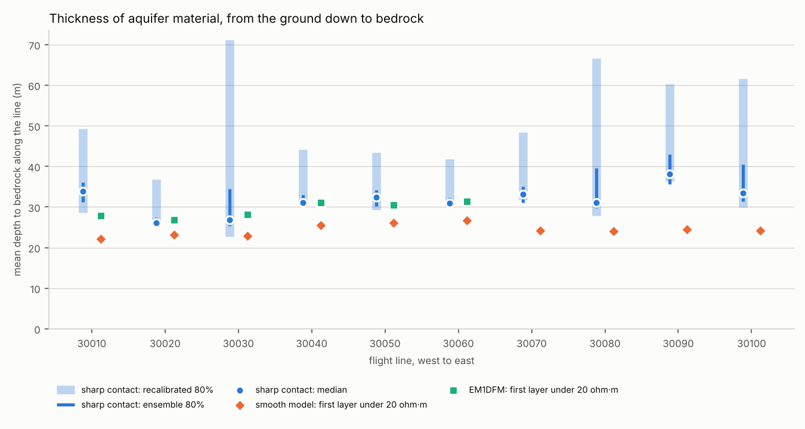

# 07 · Inverting for the depth to bedrock directly

Note 06 found the shale under the buried valley at about the right depth, but
put the floor of the valley 10–25 m too high. The reason was the question
being asked, not the method:
- **The model:** smooth resistivity in 25 fixed layers, so it ramps down to
  the shale over 10–20 m.
- **The rule:** the first layer under 20 ohm·m counts as the conductor, so
  it fires near the top of the ramp.

This note changes the question. The depth to bedrock becomes a number the
inversion solves for, with a sharp contact at that depth.

## The model

At each sounding:

```
θ = [log10 ρ of 5 fill layers,  log10 z_b,  log10 ρ of the bedrock,  δh]
```

- **The fill** runs from the surface to z_b, split into five layers in fixed
  proportions of z_b: 5, 10, 15, 30 and 40%. Every member of the ensemble
  has the same structure but its own depth.
- **Below z_b** is a bedrock half-space with one resistivity: the sharp
  contact.
- **δh** corrects the bird height, as before.

That is 8 numbers instead of 26. Each forward call also has 6 layers instead
of 25, so it is cheaper. The forward model now accepts a different set of
thicknesses for every member (`fdem.response`, tested against one call per
model).

## The prior, from boreholes the checks don't use

As in note 06, the prior comes only from boreholes with no sounding within
100 m, so the validation holes stay unseen:
- **Depth to bedrock:** 78 holes; median 6.1 m, spread 0.43 decades (a
  factor of 2.7).
- **Fill:** about 39 ohm·m, from induction logs above the contact (8 holes).
- **Bedrock:** about 14 ohm·m, from logs below the contact.

The depth prior is biased shallow. Test holes cluster where bedrock is
shallow and cheap to reach: 65 of the 78 bottom in the Brule Formation within
a few metres. A 60 m valley floor sits about 2.3 spreads above this median.
How far to widen it is chosen by marginal likelihood, along with the
along-line length and the widening of the resistivity spreads.

Everything else is note 06's machinery, unchanged:
- the along-line AR(1) prior;
- ES-MDA at each sounding;
- the ensemble RTS smoother;
- the channel gains;
- the 5% data error.

## Why the ensemble needs 400 members here

The synthetic test puts 150 ohm·m gravel on 8 ohm·m shale at 45 m, with a
prior median of 6 m. It taught something:
- **With 400 members,** two noise draws give medians of 42–55 m, and every
  80% interval contains 45 m.
- **With 100 members,** one draw sends the whole ensemble to a contact at
  115–140 m that fits the data equally well.

Depth and fill resistivity trade off: a deeper contact under a more
conductive fill gives almost the same response. A small ensemble can commit
to the wrong side of that trade-off and never come back. The settings search
therefore uses 200 members, and the final run 400.

## Results

From `uv run morrill bedrock`, then `uv run morrill aquifer`.

### What the data chose

On line 30050, the marginal likelihood chose:
- L_h = 3 km;
- the logs' spread of fill and bedrock resistivity widened by 1.5;
- the boreholes' spread of depth to bedrock **not** widened (factor 1.0).

Line 30050 crosses mostly shallow bedrock, so the search was repeated with
the likelihood summed over all 12 lines. That still uses no borehole. It
chose the same settings, and widening the depth prior lowered the likelihood
for every combination. Across all 12 settings the valley medians moved only
between 44 and 49 m. **The shallow prior is not what holds the valley floor
up.**

### One ensemble keeps one answer: three starts, pooled

> **Correction, from note 08.** The grid inversion of note 08 evaluates every
> depth at every sounding. On line 30090 it gives the deep contact a
> probability of 10⁻⁵ or less. The data there don't allow two answers: the
> deep one is a trap the Gaussian update falls into and can't leave, and the
> seed decides whether it falls in. Read "two answers" below as "two places an
> ensemble can settle". The volume gap between inversions is also mostly that
> trap: 10%, not 27–37%.

With a single ensemble, the result on some stretches of line depends on the
random seed. Three runs with different seeds (one start each, 400 members):

| Run | Valley holes (58.5, 60.3 m) | Line 30090's four shallow Brule holes (0.6–4.6 m) | Mean error, 21 holes | Inside 80% |
|---|---|---|---|---|
| seed 0 | 48.0, 47.7 m | 10–18 m | 5.5 m | 10% |
| seed 1000 | 47.0, 49.3 m | 8–12 m | 5.6 m | 14% |
| seed 2000 | 46.6, 45.5 m | **2.4–4.4 m** | 4.1 m | 29% |

All three fit the data equally well (median misfit 0.29–0.31).

**On line 30090 the data allow two answers:**
- **A shallow contact** at 2–4 m, under resistive cover, with moderately
  conductive rock below.
- **A deep contact** at 10–18 m, under about 20 ohm·m fill, on 5–7 ohm·m rock.

It is the trade-off the synthetic test showed (above): a deeper contact
under a more conductive fill fits about as well. The Kalman update is
Gaussian, so one ensemble can hold only one of the two, and its seed decides
which.

**The valley floor doesn't move:** 45.5–49.3 m in every run.

**The fix used here:** run each line from three independent starts and pool
their members into one equal-weight mixture of 1,200 surfaces
(`Settings.n_starts`).
- Where the starts disagree, the pooled interval covers both answers. At
  12-K-94 it now runs from 2.7 to 18.9 m.
- Where all three land on the same answer, it doesn't help. On line 30090
  this time, all three found the deep contact.

Three starts is a compromise between cost and coverage. More starts, or a
sampler that can hold several modes at once, would do better. That is what
MCMC buys with its 200,000 forward models.

### Run and data fit

- **Time:** 3,577 soundings in 6.6 min on 4 cores (three starts), 0.44
  core-seconds per sounding. Each start costs 0.14 core-seconds per sounding,
  5 times cheaper than the smooth model, because each forward call has 6
  layers instead of 25.
- **Fit:** the median misfit is 0.31, and 90% of soundings are under 1.16.
- **Resistivities found:** the bedrock comes out at 5–9 ohm·m, below the
  logs' 14. The fill comes out at 17–125 ohm·m.

### Against the boreholes

The same 21 holes as note 06, from the pooled run:

| Holes | n | Sharp: mean error / inside 80% | Sharp: inside recalibrated 80% | Smooth (note 06): mean error | EM1DFM |
|---|---|---|---|---|---|
| Inverted lines | 10 | 2.6 m / 30% | 90% | 1.7 m | 2.1 m |
| Uninverted lines | 11 | 8.9 m / 27% | 64% | 8.4 m | — |
| Buried valley | 2 | **12.7 m** / 0 of 2 | 2 of 2 | 20.7 m | — |
| All | 21 | 5.9 m / 29% | 76% | 5.2 m | — |

**The valley floor comes down by 5–11 m:**

| Hole | Bedrock | Smooth median | Sharp median [80%] | Sharp, recalibrated 80% |
|---|---|---|---|---|
| 2-J-97 | 58.5 m (Pierre) | 42 m | 47 m [43–53] | 31–77 m |
| 1-H-97 | 60.3 m (Pierre) | 36 m | 47 m [42–51] | 31–69 m |
| 1-J-96 | 59.7 m (Pierre) | | 60 m [52–70] | (a calibration hole) |

1-J-96 is not in the validation set: its nearest sounding with data is
240 m away. Its depth is matched to within a metre.

The valley floor still sits 12–14 m too high at the two validation holes.
It isn't the prior (above), and it isn't the seed. What's left:
- **The 1D assumption:** the bird's footprint is about 100 m wide, and the
  valley walls rise on either side.
- **Distance:** 1-H-97 is 91 m from its sounding.
- **The data's reach:** 60 m under conductive fill is near the limit of the
  lowest frequency.

### Two meanings of "bedrock"

The two answers on line 30090 come from the model having only two units.
- **For the driller,** bedrock is a formation: the top of the Brule.
- **For the EM,** it is a conductor.

The ground there probably has three units: a resistive cover, a moderately
conductive upper Brule, and a more conductive layer below. A two-unit model
must put its one contact at one of the two interfaces, and both fit.

The smooth model's 20 ohm·m threshold happens to fire at 1.8 m there, so it
does better on these holes. A three-unit model, or the borehole lithology
along the line, would settle which interface is meant.

### Are the intervals honest? Not until recalibrated

- **Raw:** 6 of the 21 holes fall inside the 80% interval (29%; 10% with one
  start). The interval's typical half-width is about 0.1 decades (±25%),
  while the actual errors have an rms of about 0.4 decades.
- **Why:** a posterior is conditional on its model. Here the model has two
  units, the ensemble can miss a second answer, and the along-line coupling
  accumulates confidence from neighbours that share the same mistake. The
  likelihood can't see any of this.

**The fix: split-conformal recalibration** (`bedrock.conformity`,
`bedrock.inflation`, `bedrock.widen`):
1. **Calibration holes:** take the boreholes that reached bedrock and whose
   nearest sounding with data is 100–300 m away. There are 15, and the checks
   never use them. Only 3 of the 15 fall inside the raw interval, the same
   story.
2. **Score each one:** how far the logged depth lies from the median, in log
   depth, in units of that side of the 80% interval. A score of 1 is on the
   edge.
3. **Pick the factor:** take the ⌈0.8 × (15 + 1)⌉ = 13th smallest score:
   **k = 4.32**.
4. **Widen:** stretch every interval 4.32-fold on each side, in log depth,
   within the model's 1–150 m.

**After recalibration, 16 of 21 validation holes are inside (76%):** 90% on
the inverted lines, 64% on the uninverted lines, and both valley holes. With
21 holes, 76% against a target of 80% is within sampling noise (±9%).
Across the single-start runs above, k ranged from 2.6 to 4.4 and the
recalibrated coverage from 57% to 76%.

The price is width: at the valley holes the recalibrated interval runs from
about 30 to 75 m. That is how well the depth is actually known with this
model.

**Why the guarantee is only approximate:** split-conformal prediction
promises 80% if the validation holes are exchangeable with the calibration
holes. They aren't quite: calibration holes lie further from their soundings,
so k should err on the wide side.

### What it means for the aquifer

`aquifer.py` turns the depth to bedrock into an amount of aquifer material.
- **Each member is a surface.** The smoother updates whole members, so
  member i is one plausible bedrock surface along its line.
- **Thickness and volume:** each surface gives a thickness from the ground to
  bedrock. Integrated over the strip of ground each line stands for (half the
  gap to each neighbouring line), it gives a volume.
- **Coverage:** the ten north–south lines' strips cover about 45 km² between
  the outermost lines.

| | Volume of aquifer material (km³) |
|---|---|
| Smooth model (first layer under 20 ohm·m) | 1.11 |
| Sharp contact, median | 1.41 |
| Sharp contact, pooled ensemble 80% | 1.38–1.54 |
| Sharp contact, recalibrated 80% | 1.50–2.20 |
| *On EM1DFM's six lines only:* smooth / EM1DFM / sharp | 0.72 / 0.86 / 0.86 |

Three things follow:
1. **The choice of inversion changes the answer by about a quarter to a
   third.** The sharp contact gives 27% more aquifer material than the smooth
   model; the single-start run gave 37% more. On the six lines EM1DFM covers,
   EM1DFM agrees with the sharp contact, and the smooth model is 16% lower.
2. **Which answer an ensemble lands on matters too.** The single-start and
   pooled runs differ by 0.1 km³, and two lines' mean thickness moved by 7–8 m
   between them. A single ensemble's ±1% hides that; the pooled ensemble's
   80% range (−3% to +9%) shows some of it.
3. **The recalibrated range sits above the raw one.** Widening in log depth
   raises the average thickness: a spread of a factor of 2 either way about
   30 m averages more than 30 m. That follows from treating the error as
   multiplicative, and from stretching each surface as a whole, as if the
   error ran coherently along the line. 36 boreholes can't confirm either
   assumption.

**What it doesn't say yet.** This is aquifer *material*, from the ground
down. A groundwater answer needs:
- **saturated thickness,** which needs water levels;
- **storage and transmissivity,** which need specific yield and hydraulic
  conductivity;
- **a flow model,** which needs wells, pumping, the river and the canals.

None of these are in the database.




## What this gives us

- **A valley floor 5–11 m deeper** than the smooth model's, from asking for
  the depth directly. The error at the two valley holes falls from 21 m to
  13 m, and it is the same in every run.
- **A lesson about ensembles:** a Gaussian ensemble can settle in a place the
  data don't support, and its seed decides whether it does. Pooling
  independent starts shows the problem but doesn't cure it; note 08's exact
  grid does.
- **A lesson about intervals:** a rigid model fits its data with false
  confidence. Boreholes the checks never use can measure that, and a single
  factor corrects it.
- **A number a water manager would use,** the volume of aquifer material.
  Here the choice of inversion seemed to move it by a quarter to a third.
  Note 08 shows most of that was the ensemble's trap: with exact inference
  the gap is 10%.

## Questions to think about

1. The depth prior comes from test holes that cluster where bedrock is
   shallow. What would an unbiased prior look like, and how could you build
   one from data you have?
2. With 100 members the ensemble found a deep contact under a conductive
   fill that fit the data as well as the truth. What extra information would
   break that tie?
3. The sharp model has 8 unknowns, the smooth model 26. Which do you expect
   to have the better-calibrated intervals, and why?
4. The three starts are pooled with equal weight. When would weighting each
   start by its marginal likelihood be better, and when would it be worse?
