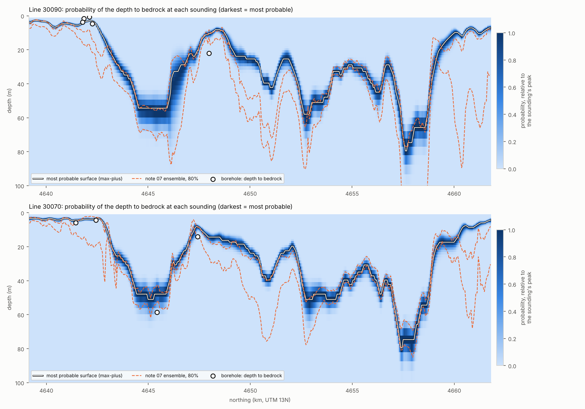
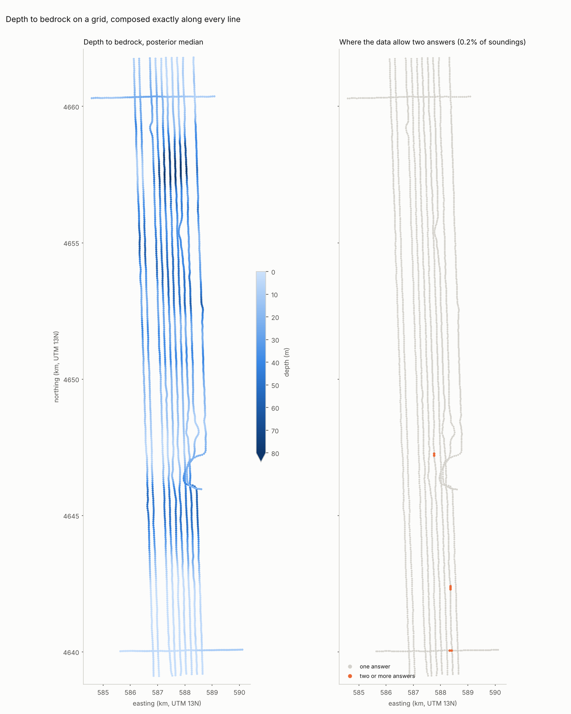
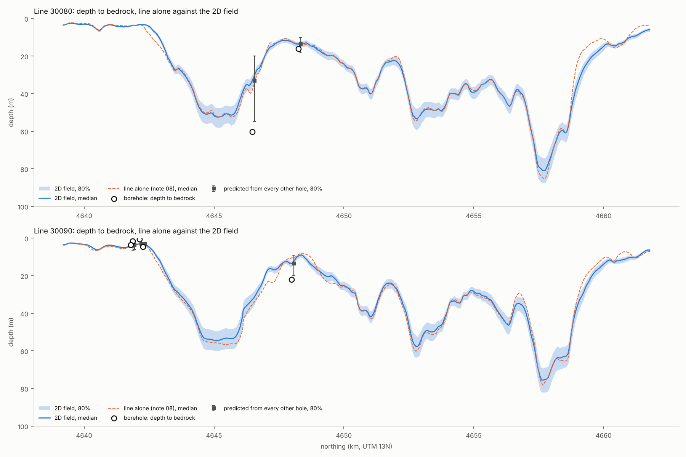
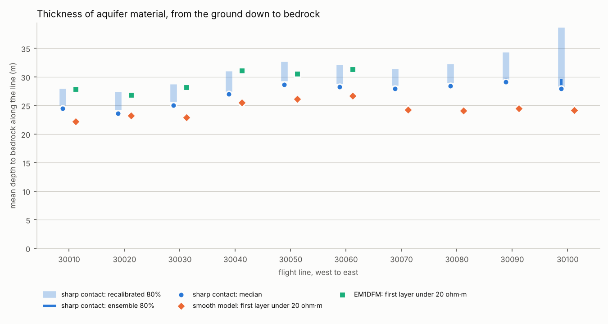

**Author:** Akbar Esfahani, [affiliation], [address]. Correspondence: [email]. ORCID: [ORCID].

**Target journal:** [to be chosen]

**Keywords:** airborne electromagnetics; ensemble Kalman methods; hidden Markov models; Bayesian inversion; groundwater; buried valley; uncertainty quantification

# Abstract

Helicopter electromagnetic surveys map alluvial aquifers along dense flight lines, but inverting them with uncertainty is costly: trans-dimensional Markov chain Monte Carlo needs about 200,000 forward evaluations per sounding. We invert a 2008 survey in Nebraska along each flight line in two ways. The first is an ensemble Kalman smoother. The second treats the inversion as a weighted relation rather than a function and composes it exactly on a grid of depths to bedrock, integrating the other parameters out at each depth. Both use priors from held-out borehole logs, are checked against 21 other boreholes, and cost 0.36–0.67 core-seconds per sounding.

A new forward model exposes a 10–12% calibration error on three channels, confirmed by two independent inversions. A smooth ensemble beats the existing inversion where bedrock is shallow (1.7 m against 2.1 m mean error) but places a buried valley floor 17–24 m too high. Inverting for a sharp contact helps in the valley, but the Gaussian ensemble settles on deep contacts the data do not support, and its seed decides where. Exact composition on the grid removes this failure, reducing the mean error at the 21 holes to 3.7 m, against 5.9 m for the ensemble. Exact inference does not make intervals honest (14% coverage), mostly because a borehole samples a point that the EM averages over 100 m. Point-scale variability from borehole pairs restores 57% coverage; split-conformal recalibration, 76%. With exact inference, the parameterization changes the volume of aquifer material by 10%.

# 1 Introduction

Helicopter frequency-domain electromagnetic (HEM) surveys measure the
electrical response of the ground every few metres along flight lines, over
areas of hundreds of square kilometres. In alluvial aquifers the response is
dominated by the contrast between resistive sand and gravel and conductive
clay, silt and shale. That contrast makes HEM data a direct route to the
geometry hydrogeologists need, above all the base of the aquifer.

Turning the measurements into resistivity requires an inversion. Deterministic
inversions such as EM1DFM (Farquharson et al. 2003) fit a smooth layered model
to each sounding. Laterally and spatially constrained inversions tie
neighbouring soundings together (Auken et al. 2005; Viezzoli et al. 2008).
These methods are fast, but they give one answer, with no statement of how well
it is determined. Bayesian alternatives answer that question. Trans-dimensional
Markov chain Monte Carlo (MCMC; Malinverno 2002; Minsley 2011; Minsley et al.
2021) samples models whose number of layers is itself unknown, and so describes
non-uniqueness directly. The price is computation. With the 2012 version of one
such code, a single test sounding took about 200,000 forward-model evaluations
and 24 minutes (section 4.9). A survey of 70,000 soundings would need years of
single-core time.

Ensemble Kalman methods sit between the two. Developed for data assimilation
(Evensen 1994, 2009) and reservoir history matching (Emerick & Reynolds 2013),
and analysed as general inverse-problem solvers (Iglesias et al. 2013), they
update an ensemble of models with covariances estimated from the ensemble
itself, at a cost of hundreds to thousands of forward evaluations. For
frequency-domain EM, Bobe et al. (2020) inverted each sounding with a Kalman
ensemble generator and obtained uncertainty estimates at a small fraction of
the cost of exhaustive sampling. Along flight lines, Karshakov (2018, 2020)
built lateral constraints into a Kalman filter for airborne EM, carrying each
sounding's estimate forward to the next.

Two further threads matter here. HEM data carry calibration errors, and
correcting them with ground information or by solving for calibration
parameters is well established (Deszcz-Pan et al. 1998; Brodie & Sambridge
2006; Minsley et al. 2010, 2014). And for this survey area, the base of the
aquifer has already been mapped regionally from airborne EM (Abraham et al.
2012). An earlier study of the same survey proposed a hybrid route to speed
(Friedel et al. 2015): invert a subset of soundings numerically, train a
machine-learning model on the inverted profiles, and let it predict resistivity
everywhere else in near real time. A model trained to reproduce an inversion,
however, inherits the inversion's limitations. It can be no better than its
training labels, and its uncertainty describes how well the inversion was
copied, not how well the ground is known (section 4.8).

This paper is a case study that combines these pieces and tests them against
boreholes. The physics is kept and made cheap with statistics: an ensemble
Kalman smoother runs along each flight line, and through a Gaussian-process
prior along the line each sounding's posterior becomes the next sounding's
prior. Relative to the work above, the paper adds:

1. **A two-sided ensemble smoother along the line.** ES-MDA updates at each
   sounding are followed by an ensemble Rauch–Tung–Striebel pass back along
   the line, extending per-sounding ensemble inversion (Bobe et al. 2020) and
   forward Kalman filtering (Karshakov 2018, 2020). The prior is learned from
   borehole logs held out of validation, and the hyperparameters are chosen by
   marginal likelihood.
2. **A controlled comparison of two parameterizations against boreholes.** A
   smooth layered model and a model with an explicit, sharp contact at the
   depth to bedrock share the same data, forward model, filter and error
   model. The comparison isolates how much the question asked moves the floor
   of a resistive buried valley.
3. **Exact composition on a depth grid.** The inversion is treated as what it
   is, a weighted relation between data and earths rather than a function,
   and composed along each line exactly on a grid of depths. In probabilities
   this is the forward-backward algorithm; in costs it is dynamic programming
   (Viterbi 1967; Aji & McEliece 2000). It removes a failure of the Gaussian
   ensemble update that no setting fixed.
4. **A test of interval calibration against held-out boreholes,** and a
   split-conformal recalibration (Vovk et al. 2005) for intervals that turn out
   too narrow.
5. **Results for this survey:** a calibration error on three channels,
   identified by two independent inversions; an inversion, with uncertainty, of
   the four lines that were never inverted; and the effect of the choice of
   inversion on the volume of aquifer material.

The cost against MCMC is reported as context, not as a contribution.

# 2 Study area and data

## 2.1 The Morrill block

**Setting.** The study area is the Morrill block of the North Platte River
valley, Scotts Bluff County, western Nebraska. Quaternary alluvium and dune
sand overlie Tertiary siltstones and sandstones (Brule Formation and Chadron
Formation of the White River Group), which rest on Cretaceous Pierre Shale.
These units make up the primary surficial aquifer. A buried paleovalley,
filled with sand and gravel, is cut through the Tertiary rocks to the Pierre
Shale at about 60 m depth along easting 588 km. The water-bearing units and
the base of the aquifer were mapped regionally from airborne EM by Abraham et
al. (2012).

**The survey.** It was flown by Fugro Airborne Surveys with the RESOLVE
system, 15–23 June 2008, for the North Platte Natural Resources District
(Fugro Airborne Surveys 2008).
- **Instrument:** five horizontal coplanar coil pairs (378, 1,776, 8,171,
  41,020 and 129,550 Hz; separation 7.9 m) and one vertical coaxial pair
  (3,345 Hz; 9.0 m). Each records in-phase and quadrature response in ppm.
- **Sampling:** 10 Hz, about 3.2 m between soundings, with a laser
  altimeter giving the bird height.
- **Morrill block coverage:** ten north–south lines about 200 m apart and
  22.7 km long, plus two east–west tie lines; 71,470 soundings in all.

## 2.2 Boreholes

The boreholes are 130 test holes of the Conservation and Survey Division,
University of Nebraska–Lincoln, with three kinds of record:
- **driller's lithology** (all 130 holes; 1,173 intervals);
- **formation picks** (102 holes), from which the depth to bedrock follows
  as the top of the first Tertiary or Cretaceous unit, with 100 holes
  reaching bedrock;
- **induction-resistivity logs** (32 holes; 37,394 readings at 3 cm
  spacing).

The logs were averaged into the model layers in conductivity, because
current flows through thin beds in parallel.

## 2.3 A database, and what building it found

**The database.** All inputs were loaded into a single relational database
(DuckDB). A manifest records every source file with checksums, and eleven
automated checks run on every build. Building it brought several data
problems to light:
- **The lithology files' elevation column** gives the midpoint of each
  interval, not its top.
- **The survey's heights** refer to the WGS84 ellipsoid, while borehole
  collars are orthometric. The offset, 14.54 m (median of 30 holes within
  100 m of a sounding; spread 0.9 m), was applied before comparing them.
- **An existing deterministic inversion** (EM1DFM; 24 layers over a
  half-space to 125 m) covers only the first six lines (41,330 soundings).
  The four eastern lines, which cross the buried valley, and the tie lines
  were never inverted.

**Validation and prior holes.** Holes within 100 m of a sounding are used
only for validation: 21 holes with bedrock picks and 12 with induction logs.
Every prior quantity is estimated from the other holes.

# 3 Methods

## 3.1 Forward model

For a magnetic dipole above horizontally layered ground (quasi-static, non-magnetic layers), the secondary field normalized by the primary is a Hankel transform over the horizontal wavenumber $\lambda$ (Ward & Hohmann 1988). For horizontal coplanar coils at height $h$ and separation $r$,

$$\frac{H_s}{H_p} = -r^3 \int_0^\infty r_{TE}(\lambda)\, e^{-2\lambda h}\, \lambda^2 J_0(\lambda r)\, d\lambda,$$

and for vertical coaxial coils $J_0(\lambda r)$ is replaced by $\tfrac12[J_0(\lambda r) - J_1(\lambda r)/(\lambda r)]$, with the sign convention of the survey data (positive over a conductor). The reflection coefficient $r_{TE} = (\lambda - \hat u_1)/(\lambda + \hat u_1)$ follows from the upward recursion $\hat u_j = u_j(\hat u_{j+1} + u_j \tanh u_j t_j)/(u_j + \hat u_{j+1}\tanh u_j t_j)$, with $u_j = (\lambda^2 + i\omega\mu_0\sigma_j)^{1/2}$ and layer thickness $t_j$.

The integral is evaluated with the trapezoid rule in $\ln\lambda$ at six points per decade over $10^{-4}$–$1$ m$^{-1}$ (24 points). Because the integrand vanishes smoothly at both ends of that interval, the rule converges very fast. It matches the closed-form image-dipole solution for a perfect conductor to within $10^{-5}$ (relative) at heights of 15–60 m, and adaptive quadrature for random layered earths to within 0.01 ppm, against noise of 5–40 ppm.

The code is vectorized over models, with one array call per ensemble, and evaluates about 2,700 earth models per second per core.

## 3.2 Prior

**Smooth layered model.** The unknowns at each sounding are

$$\theta = [\log_{10}\rho_1,\dots,\log_{10}\rho_{25},\ \delta h],$$

the resistivities of the same 24 layers and half-space as EM1DFM, plus a correction $\delta h$ to the laser altimeter height, with prior $\delta h \sim N(0, 2^2)$ m.

The prior on $\log_{10}\rho$ is Gaussian:
- **Mean and spread** come from the 19 induction logs held out of validation: mean 1.60 (about 40 ohm·m), standard deviation 0.32. The spread is multiplied by a factor chosen by marginal likelihood (section 3.4).
- **Vertical correlation** follows $\mathrm{corr}(\Delta z) = c + (1-c)\exp(-\Delta z/L_v)$, between layer centres $\Delta z$ apart.

The logs constrain the short-range correlation well: 0.87 at 1 m and 0.67 at 3 m. They do not constrain the share $c$ of variance common to the whole profile: estimates range from about 0 to 0.7 between subsets of holes, with standard errors near 0.25. So $c$ is chosen by marginal likelihood, and $L_v$ is refitted to the logs for each choice.

**Sharp-contact model.** Here the depth to bedrock $z_b$ is itself a state variable:

$$\theta = [\log_{10}\rho^{\mathrm{fill}}_1,\dots,\log_{10}\rho^{\mathrm{fill}}_5,\ \log_{10} z_b,\ \log_{10}\rho_{\mathrm{rock}},\ \delta h].$$

The fill between the surface and $z_b$ is divided into five layers in fixed proportions of $z_b$ (5, 10, 15, 30 and 40%), so every ensemble member has the same structure but its own contact depth. Below $z_b$ is a bedrock half-space. The priors are again learned from held-out holes:
- $\log_{10} z_b$: from the 78 holes that reached bedrock;
- $\log_{10}\rho$ of fill and bedrock: from induction logs above and below the logged contact.

Because test holes cluster where bedrock is shallow, the depth prior is centred shallow (median 6 m). Its spread is widened by a factor chosen by marginal likelihood.

## 3.3 Ensemble Kalman inversion along a flight line

**Along-line prior.** Along a line, $\theta$ follows a first-order autoregressive process, the discrete form of an Ornstein–Uhlenbeck (exponential-covariance) Gaussian process (Rasmussen & Williams 2006):

$$\theta_t = m + a_t(\theta_{t-1} - m) + w_t,\qquad a_t = e^{-\Delta_t/L_h},\qquad w_t \sim N\!\left(0,(1-a_t^2)\Sigma\right),$$

where $\Delta_t$ is the distance from the previous sounding. The marginal distribution at every sounding is the prior $N(m,\Sigma)$; the correlation length $L_h$ sets only how far information carries along the line.

**Update at each sounding.** An ensemble of $N$ models is updated with ES-MDA (Emerick & Reynolds 2013). The Kalman (1960) update

$$\theta_i \leftarrow \theta_i + C_{\theta d}\,(C_{dd} + \alpha R)^{-1}\,(d + \sqrt{\alpha}\,\varepsilon_i - g(\theta_i))$$

is applied $N_a = 4$ times with the data covariance inflated by $\alpha = N_a$. The covariances $C_{\theta d}$ and $C_{dd}$ are estimated from the ensemble, and $g$ is the forward model. Data errors are $\sigma = (\sigma_{\mathrm{floor}}^2 + (0.05\,|d|)^2)^{1/2}$, with the channel floors of the survey specification (5–40 ppm).

**Backward pass.** After the last sounding, an ensemble Rauch–Tung–Striebel smoother (Rauch et al. 1965; Raanes 2016) runs back along the line, so that each estimate uses data on both sides.

**Settings.**
- Every 20th sounding is used (about 64 m apart, roughly one footprint).
- Soundings flown above 60 m are forecast but not updated (1.3% of the survey).
- The ensemble has $N = 400$ members.
- For the sharp model, each line is inverted from three independent starts, and their members are pooled into one equal-weight mixture of 1,200 members. A single Gaussian ensemble keeps only one of several modes, and which one depends on its random draws; pooled restarts can keep more than one (but see section 4.4). The mixture's marginal likelihood is the mean of the starts' likelihoods. The settings search uses a single start.

Two tests fix the implementation:
1. For a linear observation operator, ES-MDA reproduces the analytical Gaussian posterior.
2. The ensemble filter and smoother reproduce the exact Kalman filter and RTS smoother of an independent linear state-space implementation, including a gap in the observations.

A "sounding-by-sounding" mode, in which every sounding starts from the same prior, serves as a per-sounding Bayesian baseline (the task MCMC performs).

## 3.4 Hyperparameters and calibration

**Hyperparameters.** The along-line correlation length $L_h$, the widening of the prior spreads, and (smooth model) the whole-profile share $c$ are chosen by maximum marginal likelihood. The ensemble filter evaluates $\log p(d_t \mid d_{1:t-1})$ at each sounding from the forecast ensemble, and these are summed along the line. The search uses line 30050, which has no borehole within 100 m, so it cannot draw on validation data. Because line 30050 crosses mostly shallow bedrock, the sharp model's search was repeated with the marginal likelihood summed over all 12 lines, which also uses no borehole; it chose the same settings.

The relative data error is not chosen this way. The likelihood treats soundings as conditionally independent, so it rewards ever smaller errors and cannot see model errors that repeat from sounding to sounding: the 1D assumption, calibration, and the difference in support between a borehole log and the bird's footprint. The relative error is therefore fixed at 5%, the level at which the independent EM1DFM models miss the data on most channels (section 4.1). The sensitivity to that choice is reported in section 4.7.

**Calibration.** Systematic misfit in three channels (section 4.1) motivated one survey-wide gain per channel, estimated as the median ratio of measured to predicted data after an inversion of line 30050. A gain common to all channels is indistinguishable from a change in bird height, so the geometric mean of the gains is fixed at 1.

Iterating the estimate does not converge for every channel:
- **The coaxial and 8.2 kHz in-phase gains** settle in the first pass.
- **The 400 Hz in-phase and 129 kHz gains** keep drifting, because deep conductivity and bird height trade off against them.

A single pass is therefore used.

## 3.5 Validation and cost

**Validation.**
- **Bedrock depth:** the estimate at the nearest sounding with data, within 100 m, is compared with the borehole depth to bedrock.
- **Smooth model:** the depth to conductor (top of the first layer below 1.8 m with $\rho < 20$ ohm·m, the binary split of Friedel et al. 2015) is compared.
- **Sharp model:** $z_b$ itself is compared.
- **Scores:** mean absolute error of the median, and the fraction of holes whose depth lies inside the 80% interval. For the smooth model, the interval counts as containing the depth if it reaches the model layer that holds it.
- **Resistivity:** the smooth model is also compared with the induction logs and with EM1DFM.

**Recalibrating the intervals.** A posterior interval describes uncertainty given its model, not the error of the model itself. To test and correct for that, the sharp model's intervals were recalibrated by split conformal prediction (Vovk et al. 2005; Angelopoulos & Bates 2023) on a calibration set of boreholes that validation never uses: holes that reached bedrock and whose nearest sounding with data lies 100–300 m away. For each calibration hole the score

$$s = \begin{cases} (\ell_{50} - \ell)/(\ell_{50} - \ell_{10}) & \ell < \ell_{50} \\ (\ell - \ell_{50})/(\ell_{90} - \ell_{50}) & \ell \ge \ell_{50} \end{cases}$$

measures how far the logged depth $\ell = \log_{10} z$ lies from the median, in units of that side of the 80% interval ($s \le 1$ means inside). The factor $k$ is the $\lceil 0.8(n+1)\rceil$-th smallest of the $n$ scores, and each side of every interval is stretched $k$-fold in log depth. If validation holes were exchangeable with calibration holes, the stretched intervals would contain at least 80% of them. Calibration holes lie further from their soundings than validation holes do, so the factor should err on the wide side.

**Aquifer material.** Each member of the smoothed sharp-model ensemble is a coherent surface along its line, because the smoother updates whole members. The thickness from the ground to bedrock, integrated over the strip of ground each north–south line stands for (half the distance to each neighbouring line, so the strips cover the ground between the outermost lines), gives a volume per member. Lines are inverted independently, so members of different lines combine freely. The same volume follows from the medians of the smooth model and EM1DFM, with "no conductor" counted at the 125 m base of those models.

**Cost.** Run time is compared with the trans-dimensional MCMC code of Minsley (2011) as it existed in 2012, with a run log recorded then and benchmarks rerun here in GNU Octave 8.4 (section 4.9 and Supplement S1).

## 3.6 Exact composition on a depth grid

**The inversion as a relation.** A forward model maps one earth to one set of data, but many earths fit the same data, so the inversion is a weighted relation between the two spaces: in categorical terms a profunctor, of which Bayesian inversion of Markov kernels is a special case (Cho & Jacobs 2019; Fritz 2020). On grids, such a relation is an array, and two of them compose through a shared space as

$$(Q \circ P)[a, c] = \bigoplus_b P[a, b] \otimes Q[b, c],$$

for a semiring $(\oplus, \otimes)$. With log-sum-exp and addition on log-probabilities, composition along a line is the forward-backward algorithm (Rabiner 1989), whose linear-Gaussian case is the Kalman filter and RTS smoother. With max and addition, it is dynamic programming, which gives the single most probable sequence (Viterbi 1967). Both are instances of the generalized distributive law (Aji & McEliece 2000). On a grid neither assumes a Gaussian posterior.

**What goes on the grid.** A grid represents a posterior faithfully only if its spacing is finer than the posterior's width. At typical Morrill earths the Fisher information gives posterior standard deviations of 0.02–0.2 decades for the resistivities, 0.04–0.06 decades for $\log_{10} z_b$, and 0.4–1 m for the height correction. So only $z_b$ is placed on a grid: 80 values from 1 to 150 m, 0.027 decades apart. The other seven numbers $\psi$ of the sharp-contact model are integrated out at every grid depth of every sounding,

$$L_t(z) = \int p(d_t \mid z, \psi)\, p(\psi)\, d\psi,$$

itself a composition through the space of $\psi$. The integral uses a Laplace approximation (Tierney & Kadane 1986) around a Levenberg–Marquardt fit. Each fit starts from the same depth at the previous sounding, and every tenth sounding it is repeated from the prior mean, keeping the better of the two. The earth and prior are those of section 3.2, so the grid and the ensemble share one Bayesian model. The differences are the Laplace step and that $\psi$ is not coupled along the line.

**Along the line.** The AR(1) prior on $\log_{10} z_b$ becomes a kernel between neighbouring grids. A Metropolis–Hastings correction (Hastings 1970) of the discretized Gaussian conditional keeps the grid prior exactly invariant. Composing in the two semirings gives the posterior at every sounding and the most probable surface. Sampling backwards through the forward messages (Carter & Kohn 1994) gives exact joint draws of whole surfaces for the aquifer volume.

**Settings for free.** $L_t(z)$ depends neither on $L_h$ nor on the width of the depth prior. Both are therefore chosen by the evidence summed over all 12 lines, which needs only the composition, not new fits.

**Tests.** For a linear forward model the Laplace step is exact. For a linear-Gaussian line the grid posterior matches the exact Kalman smoother to 0.01 in mean and standard deviation. On short lines both semirings match brute force over every path, and composition is associative with an identity.

## 3.7 Across lines, and boreholes as data

**One field.** Exact composition of the 2D field is infeasible (its cost grows as 80 raised to the number of lines), but each line's surface given its neighbours' surfaces is a chain that section 3.6 composes exactly. Drawing each line's whole surface in turn from that conditional is a Gibbs sampler with whole lines as blocks (Carter & Kohn 1994), which converges to the exact posterior of the 2D model; each line's exact conditional marginals are averaged over sweeps (Rao–Blackwellisation). The 2D model links each sounding to its nearest sounding on each neighbouring line and to tie lines where they cross. Across a link, $\log_{10} z_b$ changes by a Gaussian amount with variance $v\,d$ for soundings $d$ metres apart, $v = 2\sigma^2/L_h$ being the rate the along-line evidence chose (an isotropy assumption, checked by halving and doubling $v$). On a two-line test field the sampler reproduces brute-force enumeration of the joint posterior.

**Point against footprint.** A borehole samples the bedrock surface at a point; the bird averages it over about 100 m. Pairs of boreholes measure the point-scale variability directly. For the 79 holes that are not validation holes, pairs closer than 400 m give a variance of the difference in $\log_{10}$ depth of $c_0 + b\,d$, with $c_0 = 0.0024$ and $b = 2.84 \times 10^{-4}$ m$^{-1}$. A prediction for a borehole's depth is therefore the EM posterior at its nearest sounding, blurred by this variance.

**Boreholes as data.** A borehole enters as one more link, $\log_{10} z_{\mathrm{hole}} \sim N(\log_{10} z_b, c_0 + b\,d)$, at its nearest sounding. Two designs are scored: the 15 calibration holes as data, predicting the 21 validation holes; and every other hole as data, predicting each validation hole in turn (leave one out).

# 4 Results

## 4.1 Forward model and survey calibration

**The forward model against an independent inversion.** EM1DFM's resistivity models for the six inverted lines were run through the forward model and compared with the measured data (Table 1). Nine channels agree to within 1–5%, with correlations of 0.989–0.999. Three are off by 10–17%, consistently, whatever the geology: the 378 Hz in-phase, both coaxial channels and the 8,171 Hz in-phase.

**Table 1.** Data predicted from EM1DFM's models by the forward model, against the measured data (six inverted lines). Median ratio and correlation per channel.

| Channel | Predicted / measured | Correlation |
|---|---|---|
| 1,776 Hz I, Q | 1.00, 0.98 | 0.999, 0.999 |
| 378 Hz Q | 1.00 | 0.999 |
| 8,171 Hz Q; 41 kHz I, Q | 0.98; 0.98, 0.96 | ≥ 0.996 |
| 129 kHz I, Q | 1.06, 1.03 | 0.995, 0.989 |
| **378 Hz I** | **0.83** | 0.990 |
| **coaxial 3,345 Hz I, Q** | **0.87, 0.88** | 0.996 |
| **8,171 Hz I** | **1.10** | 0.999 |

**The same channels, from a different inversion.** The ensemble inversion, fitted to the uncorrected data on line 30050, misses the same channels in the same direction. One pass of the gain estimate (section 3.4) gives:
- coaxial in-phase and quadrature: 1.12 and 1.11 (measured high);
- 8,171 Hz in-phase: 0.90 (measured low);
- the other nine channels: 0.93–1.03.

When two inversions of different design cannot fit the same channels in the same way, the error lies in the data. The most likely cause is a calibration error on those channels. Applying the gains raised the log marginal likelihood of line 30050 from −20,272 to about −18,900, for the cost of eleven numbers. All results below use the corrected data.

## 4.2 Smooth layered model

**Settings.** Of 27 combinations searched on line 30050, the marginal likelihood chose:
- $L_h = 3$ km;
- prior spreads widened by 1.5 (one standard deviation is a factor of 3 in resistivity);
- $c = 0$, in the seven best combinations: given the airborne data, the deep layers are better left independent of the shallow ones. $L_v$, refitted to the logs with $c = 0$, is 9.1 m.

The scores of the leading settings are close (log marginal likelihoods −18,767, −18,799 and −18,803 for $L_h$ = 3, 6 and 1.5 km). The long correlation length mostly says that soundings 64 m apart tell nearly the same story.

**Run and data fit.** All 12 lines (3,577 soundings) were inverted in 9.9 min on four cores, or 0.67 core-seconds per sounding. The median mean squared normalized residual per sounding is 0.53, and 90% of soundings are below 0.95, so the data are fitted to within the assumed error. The median height correction is −0.2 m; 80% of soundings fall between −2.1 and +1.6 m.

**Against EM1DFM** (six inverted lines, 1,999 soundings):
- **resistivity:** the two agree to about 0.15 decades (40%) through the top 60 m (median absolute difference 0.14–0.15 decades), and 0.22 decades below. EM1DFM's value lies inside the ensemble's 80% interval for 66–86% of layer values, depending on depth.
- **depth to conductor:** median absolute difference 2.4 m, with no bias; EM1DFM's value lies inside the 80% interval at 83% of soundings.

**Against the boreholes** (Table 2). Where bedrock is shallow, on the inverted lines, the along-line ensemble is more accurate than EM1DFM (mean absolute error 1.7 m against 2.1 m), and its intervals contain the borehole depth at 9 of 10 holes. Run sounding by sounding from the same prior, the error rises to 2.7 m and coverage falls to 40%. On the four uninverted lines the error is 8.4 m. At the two buried-valley holes it is 21 m: the medians are 42 and 36 m, against 58.5 and 60.3 m in the boreholes, and neither interval reaches the logged depth.

**Table 2.** Depth to conductor (smooth model) against borehole depth to bedrock, at the 21 holes within 100 m of a sounding with data. Mean absolute error of the median, and fraction of holes inside the 80% interval.

| Holes | n | Along the line | Sounding by sounding | EM1DFM |
|---|---|---|---|---|
| Inverted lines | 10 | **1.7 m / 90%** | 2.7 m / 40% | 2.1 m |
| Uninverted lines | 11 | 8.4 m / 27% | 8.7 m / 55% | — |
| Buried valley (2-J-97, 1-H-97) | 2 | 21 m / 0 of 2 | 23 m / 1 of 2 | — |

**Why the valley floor is too high.** The profiles at the valley holes show the cause (Fig. 1). At 1-H-97 the inversion finds a strong conductor (3.6–7.5 ohm·m) from 63.6 m, the first layer top below the logged shale, so the shale is seen at about the right depth. It also puts 10 ohm·m at 36–42 m, where the driller logged sand and gravel. At 2-J-97 the resistivity falls gradually, to 11–22 ohm·m from 48 m and 3.4 ohm·m from 84 m. The induction log there reads 30–47 ohm·m down to 55 m, and clay begins at 58.5 m. Three things combine:
1. **The fill is not very resistive.** It logs at 30–80 ohm·m, only a factor of two above the 20 ohm·m threshold.
2. **The prior is smooth.** A correlated Gaussian cannot make a sharp step; it ramps down to the shale over 10–20 m.
3. **The rule takes the first layer below 20 ohm·m,** so it fires near the top of the ramp.

**Against the induction logs** (12 holes, 160 layer values), the rank correlation is 0.58, against 0.67 for EM1DFM where it exists. The ensemble reads 0.13 decades (35%) more resistive than the logs, and the log lies inside the 80% interval for 44% of values. That fraction is not a fair test of the interval, which describes the average over a footprint of about 100 m rather than the metre around a borehole. Both inversions read 25–35% more resistive than the logs throughout.

## 4.3 Sharp-contact model

**Prior and settings.** The depth prior, from the 78 held-out holes that reached bedrock, has a median of 6.1 m and a spread of 0.43 decades. Fill and bedrock resistivity, from logs above and below the logged contact (8 holes), are about 39 and 14 ohm·m. The marginal likelihood on line 30050 chose $L_h = 3$ km, resistivity spreads widened by 1.5, and an unwidened depth prior. Summed over all 12 lines it chose the same, and widening the depth prior lowered the likelihood for every combination. Across all 12 settings, the medians at the two valley holes stayed between 44 and 49 m: the shallow-centred prior is not what limits the valley floor.

**One ensemble keeps one answer.** With a single start, the result on some stretches of line depends on the random seed (Table 3). In three single-start runs, the two valley holes stayed at 45.5–49.3 m. On line 30090, though, four shallow Brule holes (bedrock at 0.6–4.6 m) came out at 8–18 m in two runs and at 2.4–4.4 m in the third. All three runs fit the data equally well (median misfit 0.29–0.31). The ensemble can settle on a shallow contact under resistive cover, or on a deeper one under fill of about 20 ohm·m on rock of 5–7 ohm·m. This is the depth–resistivity trade-off of the synthetic test, and the seed decides where it settles. The final ensemble runs pool three independent starts per line (section 3.3). Section 4.4 shows that the deep contact is not supported by the data.

**Table 3.** Sharp-contact model, single starts with different seeds and the pooled run, against the 21 validation holes.

| Run | Valley holes (58.5, 60.3 m) | Line 30090 shallow holes | Mean error | Inside 80% | $k$ | Inside recalibrated 80% |
|---|---|---|---|---|---|---|
| Single start, seed 0 | 48.0, 47.7 m | 10–18 m | 5.5 m | 10% | 4.36 | 71% |
| Single start, seed 1000 | 47.0, 49.3 m | 8–12 m | 5.6 m | 14% | 4.18 | 76% |
| Single start, seed 2000 | 46.6, 45.5 m | 2.4–4.4 m | 4.1 m | 29% | 2.58 | 57% |
| **Three starts, pooled** | **46.9, 46.6 m** | **12–18 m** | **5.9 m** | **29%** | **4.32** | **76%** |

**Run and data fit.** The pooled run took 6.6 min on four cores, or 0.44 core-seconds per sounding (0.14 per start, with six layers per forward call instead of 25). The median misfit is 0.31, and 90% of soundings are below 1.16. The bedrock comes out at 5–9 ohm·m and the fill at 17–125 ohm·m.

**Against the boreholes** (Table 4). In the buried valley the sharp contact cuts the error of the smooth model from 20.7 to 12.7 m: the medians at 2-J-97 and 1-H-97 are 47 m, against 58.5 and 60.3 m in the boreholes. A third valley hole, 1-J-96 (59.7 m), is not in the validation set because its nearest sounding with data lies 240 m away. There the median is 60 m. Where bedrock is shallow, the sharp model is less accurate than the smooth one (2.6 m against 1.7 m on the inverted lines).

**Table 4.** Pooled sharp-contact depth to bedrock against the 21 validation holes. Mean absolute error of the median; fraction inside the 80% interval, before and after recalibration (section 3.5).

| Holes | n | Mean error | Inside 80% | Inside recalibrated 80% | Smooth model: mean error |
|---|---|---|---|---|---|
| Inverted lines | 10 | 2.6 m | 30% | 90% | 1.7 m |
| Uninverted lines | 11 | 8.9 m | 27% | 64% | 8.4 m |
| Buried valley | 2 | 12.7 m | 0 of 2 | 2 of 2 | 20.7 m |
| All | 21 | 5.9 m | 29% | 76% | 5.2 m |

**Interval calibration.** Even pooled, the intervals are far too narrow: only 6 of 21 validation holes, and 3 of the 15 calibration holes, lie inside them. The split-conformal factor from the calibration holes is $k = 4.32$. After stretching, 76% of validation holes (16 of 21) lie inside, within sampling error of the 80% target for 21 holes (±9%). Across the single-start runs, $k$ ranged from 2.6 to 4.4 and the recalibrated coverage from 57% to 76%. The price is width: at the valley holes the recalibrated intervals run from about 30 to 75 m (Fig. 3).

## 4.4 Exact composition on a depth grid

**Settings.** One pass of per-sounding fits took 5.4 min on four cores (0.36 core-seconds per sounding). The evidence summed over all lines then ranked 15 combinations of $L_h$ and depth-prior width in seconds. The best three (24 km with the depth spread widened 1.5-fold, 12 km unwidened, 6 km narrowed to 0.75) lie within 19 log-units of each other. All three allow a change of about 0.05 decades in $\log_{10} z_b$ between soundings 64 m apart. The data constrain that increment, not $L_h$ itself. Note 07's choice, 3 km, scores 300 log-units lower. The top setting is used.

**The deep contact was a trap.** At the four shallow Brule holes of line 30090, where the ensembles returned 12–18 m, the grid posterior medians are 2.9–4.2 m (bedrock at 0.6–4.6 m; Fig. 5). The probability that $z_b$ exceeds 8 m is $10^{-5}$ or less at each. The deep contact is not a second answer in the data. It is a place where the Gaussian update can settle and from which it cannot leave. Only 7 of 3,577 soundings (0.2%) have posteriors with two separate modes, none at a validation hole (Fig. 6).

**Against the boreholes** (Table 5). The grid is the most accurate inversion here. Where bedrock is shallow it beats EM1DFM (1.5 m against 2.1 m), and on the uninverted lines it cuts the error by a third. At the two valley holes it does worse than the pooled ensemble. 1-H-97, 91 m from its sounding, comes out at 38 m [34–43] against the ensemble's 47 m; at 2-J-97 both give 47 m. At 1-J-96 (59.7 m), a calibration hole, the grid gives 55 m [48–63]. The median misfit at the most probable surface is 0.21, against 0.31 for the ensemble.

**Table 5.** Depth to bedrock against the 21 validation holes: mean absolute error, by inversion.

| Holes | n | Grid | Ensemble, pooled | Smooth model | EM1DFM |
|---|---|---|---|---|---|
| Inverted lines | 10 | **1.5 m** | 2.6 m | 1.7 m | 2.1 m |
| Uninverted lines | 11 | **5.7 m** | 8.9 m | 8.4 m | — |
| Buried valley | 2 | 17.0 m | **12.7 m** | 20.7 m | — |
| All | 21 | **3.7 m** | 5.9 m | 5.2 m | — |

**Exact inference, overconfident intervals.** The errors halve in log depth (rms 0.23 decades, against 0.43 for the ensemble), but the intervals narrow as well (typical half-width 0.06 decades). Only 3 of 21 validation holes, and 4 of the 15 calibration holes, lie inside the 80% intervals. With the split-conformal factor $k = 4.08$, 16 of 21 (76%) do. The comparison separates two failures. The ensemble's trap is a failure of inference, which exact composition removes. The overconfidence is a failure of the model: a one-dimensional, two-unit earth, nuisance parameters uncoupled along the line, and a borehole that samples a point where the bird averages about 100 m. Exact inference cannot remove that, because its posterior is exact for the wrong model.

## 4.5 One surface across the block, and boreholes as data

**Across lines.** The field has 3,783 links; across 200 m the depth may change by 0.083 decades. Two chains of 300 sweeps took 1.2 min and agree on the median to 0.001 decades at the median sounding. The mean error at the 21 validation holes falls from 3.72 to 3.56 m (3.56 and 3.62 m with the across-line variance halved and doubled). The valley holes do slightly worse (19.0 m). 1-H-97 sits beside a steep valley wall, and its nearest sounding, 91 m away, is on the flank, where the surface rises about 20 m in 300 m (Fig. 7). The field's intervals are narrower still, holding 10% of the holes.

**Point against footprint.** Boreholes less than 100 m apart differ by 0.14 decades (38%) in depth to bedrock, and those 100–200 m apart by 0.23 decades. That is roughly ten times the variance of the EM-scale surface over the same distances. Adding this point-scale variability, measured only from non-validation holes, raises the validation coverage of the field's 80% intervals from 10% to 57%. Nothing is fitted to the holes being scored. Most of the overconfidence found in sections 4.3 and 4.4 is therefore a mismatch of scale. The rest is genuine model error: 1-H-97 on the valley wall, 1-G-96 (a Chadron contact placed 8 m too high), and the shallowest holes (0.6–1.5 m), which lie below the model's 1 m floor.

**Boreholes as data.** With the point-scale variability as their error, the 15 calibration holes as data give a mean error of 3.53 m at the validation holes, and every other hole as data, leave one out, gives 3.56 m. Coverage is 57% in both designs. A hole 50 m from a sounding measures the footprint surface to about ±35%, while the EM already constrains it to about ±12%, so the holes receive little weight. They would matter where the EM is biased and holes are dense. Here the bias is in the valley, where only three holes reach the floor.

**Toward lithology.** Retraining note 04's histogram model on the grid inversion's five fill layers (58 holes, 280 layers, one hole left out at a time) gives an accuracy of 0.68, against 0.67 for the 20 ohm·m rule. It recognizes no fine layers. The fill's resistivity does not separate silt and clay from sand at this resolution, so the chain from depth to lithology adds no information here.

## 4.6 Consequence for the volume of aquifer material

Integrated over the ten north–south lines' strips (about 45 km²), the inversions give different amounts of aquifer material between the ground and bedrock (Table 6, Fig. 8). With exact inference the sharp contact gives 10% more than the smooth model (1.22 against 1.11 km³). The ensembles gave 27–37% more, but most of that surplus came from contacts trapped too deep under shallow bedrock: the mean thickness on line 30090 falls from 38 m (pooled ensemble) to 29 m (grid). On the six lines EM1DFM covers, the grid lies between the smooth model and EM1DFM. The 10% difference between the smooth and sharp models is still several times any single run's posterior spread (±1% for the grid).

**Table 6.** Volume of aquifer material under the ten lines' strips.

| | Volume (km³) |
|---|---|
| Smooth model (first layer under 20 ohm·m) | 1.11 |
| Grid, sharp contact: median (80%) | 1.22 (1.22–1.24) |
| Grid, recalibrated: 80% | 1.30–1.36 |
| 2D field (section 4.5): median (80%) | 1.25 (1.24–1.26) |
| Ensemble, sharp contact: pooled / single start | 1.41 / 1.52 |
| EM1DFM's six lines only: smooth / EM1DFM / grid | 0.72 / 0.86 / 0.77 |

The recalibrated range lies above the raw one. Stretching each surface in log depth raises the average thickness, since a multiplicative spread about a median has a mean above it. The range also assumes that the structural error runs coherently along each line. Neither assumption can be checked with 36 boreholes. Section 4.5 shows that most of the recalibration factor is point-scale roughness, which averages out over an area, so the recalibrated range overstates the uncertainty of a volume.

## 4.7 Sensitivity to the data error

The marginal likelihood prefers ever smaller relative data errors, down to the channel floors: 1% scores −17,727 on line 30050, against −18,767 for 5%. At 1% the data are still fitted to within the error (median misfit 0.82), so the measurement noise is indeed small. The errors that matter are of another kind: the earth is not one-dimensional, the calibration is imperfect, and the bird averages over about 100 m where a log averages over a metre. All three repeat from one sounding to the next, which a likelihood that treats soundings as independent cannot see. Table 7 shows the trade-off for the smooth model.

**Table 7.** Smooth model at 1% and 5% relative data error, scored against boreholes and logs.

| Data error | Depth error, inverted lines | Inside 80%, inverted lines | Inside 80%, uninverted lines | Logs: rank correlation, inside 80% |
|---|---|---|---|---|
| 1% (likelihood's choice) | 1.6 m | 70% | 45% | 0.49, 36% |
| 5% (used) | 1.7 m | 90% | 27% | 0.58, 44% |

Neither setting is better everywhere: 5% is better on the inverted lines and the logs, and worse on the uninverted lines. Neither finds the valley floor.

## 4.8 A learned surrogate as a baseline

To test the premise of the hybrid approach, a gradient-boosting model (Friedman 2001) was trained to reproduce EM1DFM's depth to conductor from the measured channels and bird height. This is a stand-in in the spirit of Friedel et al. (2015), not a replication of their method. Two kinds of input were compared: the raw channels, and four along-line features from a linear state-space model fitted by expectation–maximization (Shumway & Stoffer 1982), with bird height as an explicit input.

**It copies the inversion well.** With each of the six inverted lines held out in turn (39,886 soundings), the raw channels reproduce EM1DFM's depth to conductor with a mean absolute error of 2.3 m ($R^2$ = 0.93). The state-space features do slightly worse (2.9 m, $R^2$ = 0.92), because the inversion is itself a sounding-by-sounding function of the raw channels.

**It inherits the inversion's limits.** On the four uninverted lines, both inputs place the deepest predictions exactly where the valley holes are, so the valley is detected. But the predictions there are 15–40 m too shallow:
- 2-J-97 (58.5 m): 44 m from the raw channels, 45 m from the features;
- 1-H-97 (60.3 m): 37 and 33 m;
- 1-J-96 (59.7 m): 37 and 20 m.

The 80% intervals from the state-space features contained the borehole depth at none of the 12 holes on those lines. They describe how well the inversion was copied, not how well the ground is known. The surrogate's mean error on the 11 uninverted-line holes of Table 2 (6.8–6.9 m) is lower than the smooth ensemble's (8.4 m), mostly because of two holes (1-G-96 and 2-G-96) where the ensemble finds conductive ground near the surface and the driller logged silt. What the ensemble adds is intervals that sometimes contain the truth.

## 4.9 Cost against MCMC

**The 2012 benchmark.** The trans-dimensional MCMC code of Minsley (2011), as configured in 2012, left a run log for a test sounding from an Alaskan survey, recorded on 11 July 2012. The settings were up to 30 layers between 2 and 150 m, a smoothness prior on the change in log resistivity between layers, and a relative data error solved for, with bird height and calibration held fixed. The chain counts as burned in at the first accepted model whose misfit reaches the target, and then runs 100,000 further iterations. The log records 99,681 burn-in iterations, so the sounding took about 200,000 forward evaluations and 1,425 s (about 7 ms per iteration).

**Table 8.** Cost per sounding, and for the survey, against the 2012 MCMC run.

| | MCMC (logged run, 2012) | Smooth ensemble | Sharp-contact ensemble | Depth grid |
|---|---|---|---|---|
| Forward evaluations per sounding | about 200,000 | 1,600 (400 × 4) | 4,800 (3 starts × 400 × 4) | about 4,000 (80 depths × Laplace fits) |
| Time per sounding | 1,425 s | 0.67 core-s | 0.44 core-s | 0.36 core-s |
| All 71,470 soundings | about 3.2 years on one core | about 13 core-hours | about 9 core-hours | about 7 core-hours |

The ensembles and the grid use 40–125 times fewer forward evaluations. In wall time the gap is 2,100–4,000 times, but part of that is the machine and language: the 2012 run was in MATLAB with live plotting enabled. A modern, parallel MCMC would close some of the wall-time gap, though not the gap in forward evaluations.

**The 2012 modifications.** Two changes the author made to the MCMC code in 2012, vectorization of the code base and a burn-in stopped on detection, are measured in Supplement S1. Together they cut the time per sounding by about 32%, which does not change the comparison above.

# 5 Discussion

**Borrowing along the line is what makes the ensemble method work.** Run sounding by sounding from a broad prior, ES-MDA cannot fit the data: the median misfit stays at 2.0–2.3 whether it takes 4, 8 or 16 steps. The ensemble update is Gaussian. It can shift and stretch a cloud of models, but from a broad start the cloud spans models whose responses differ nonlinearly, and a linear step cannot reach the answer. Along the line, each sounding starts from its neighbour's posterior, so each update is small and nearly linear. The along-line prior is therefore not just a smoothness preference; it is what keeps the Kalman update in its linear regime. It also improves accuracy where it can be checked (Table 2: 1.7 m against 2.7 m on the inverted lines). The cost is that sharp lateral changes are smoothed at the scale of $L_h$, and the method needs flight lines dense enough for neighbours to resemble each other.

**What is inverted for, and how.** The smooth and sharp ensembles use the same data, forward model, filter, smoother, gains and error model. They differ only in the question asked, and they place the valley floor about 10 m apart (section 4.3). A smooth Gaussian prior cannot represent a step, so a threshold on a smooth model fires early on the ramp above it. Asking for the depth of a contact directly removes that bias by construction. Trans-dimensional MCMC achieves something similar by letting the number and position of boundaries vary (Malinverno 2002; Minsley 2011). A fixed parameterization with an explicit contact gets much of that benefit at a small fraction of the cost, when the question is a single surface. How the inversion is done matters too. The sharp-contact ensemble and the depth grid share one Bayesian model, yet the grid cuts the mean error from 5.9 to 3.7 m, because the ensemble's Gaussian update settles in places the data do not support (section 4.4).

**Exact composition, and what the relational view buys.** Writing the inversion as a relation and composing it along the line does not add information; it removes an approximation. The forward-backward and Viterbi recursions are classical, and their grid form is practical here because only one number per sounding, the depth to bedrock, needs a grid; the other seven are integrated out at each depth. Three things follow. The posterior can take any shape, so a trap like that of the ensemble cannot occur. The two semirings give the probabilities and the most probable surface from the same code. And because the per-sounding evidence does not depend on how soundings are linked, the linking can be chosen by evidence at negligible cost. The same composition extends naturally to the next steps: across lines, to boreholes as a second set of observations, and along the chain from earth to lithology, hydraulic conductivity and heads.

**Which bedrock is being mapped.** The smooth model's threshold and the sharp contact are different surfaces. Where the top of the Brule is resistive, the 20 ohm·m threshold fires near the surface and happens to agree with the driller. In the buried valley the threshold fires early on the ramp above the shale, and the sharp contact is better. An EM-derived bedrock map should say which surface it maps.

The remaining valley shortfall, 12–22 m at the two validation holes, is set neither by the prior, which moved the ensemble's valley medians by less than a metre when widened, nor by the seed (45.5–49.3 m in every run), nor by the inference (the grid gives 38–47 m). Three explanations remain and cannot be separated with these data. The 1D assumption ignores the valley walls inside a footprint about 100 m wide. One of the holes is 91 m from its sounding. And 60 m under conductive fill is near the limit of the lowest frequency.

**Why it matters for groundwater.** With exact inference, the volume of aquifer material under the survey lines differs by 10% between the smooth and sharp models, while each run's posterior claims about ±1%. An approximate inference can make the gap look three times larger (section 4.6). Storage and transmissivity scale with saturated thickness, so the same discrepancy carries into any groundwater budget built on one inversion with its stated uncertainty. Propagating the base of the aquifer into a flow model, together with the spatial continuity of the aquifer material (Friedel & Iwashita 2013), needs water levels, hydraulic properties and the river and canal boundaries, which are outside this study. What the results here show is that the structural choice in the inversion, not the posterior spread within one model, dominates the uncertainty such a model would inherit.

**The intervals are conditional on the model.** A posterior describes uncertainty given its model: the parameterization, the one-dimensional earth, and the error model. When the model is close to right, as for the smooth model at shallow-bedrock holes, the intervals are honest (90% coverage). When it is rigid and sometimes wrong, as for the two-unit model where the stratigraphic contact is not the electrical one, they are far too narrow. Exact inference on the grid does not help: its intervals hold 14% of the validation holes. Much of the gap, though, is not an error of the EM model at all. A borehole samples a point, while the EM interval describes an average over about 100 m. Borehole pairs show the surface to be roughly ten times rougher at point scale than at footprint scale, and that variability, measured without the validation holes, accounts for most of the gap (10% → 57% coverage). The remainder is model error, which the likelihood cannot detect because it repeats from sounding to sounding. The split-conformal step used here (Vovk et al. 2005; Angelopoulos & Bates 2023) is a cheap guard. It uses boreholes that are neither in the prior's validation set nor near enough to be used for validation, and it makes no assumption about why the model is wrong. Its guarantee rests on the calibration and validation holes being exchangeable. They are not quite: calibration holes lie 100–300 m from the nearest sounding, validation holes within 100 m, so the recalibrated intervals should err on the wide side.

**A calibration error in the survey data.** Two inversions of different design, one deterministic and one Bayesian, cannot fit the coaxial channels or the 8,171 Hz in-phase, and they miss them in the same direction by the same amount. The coaxial channels read about 12% high and the 8,171 Hz in-phase about 10% low, relative to the other channels. Survey-wide gains are a simple correction, but they cannot distinguish a calibration error from a systematic departure from the one-dimensional earth, and two of the gains (378 Hz in-phase, 129 kHz) are not identifiable from bird height and deep conductivity. The survey should be recalibrated, or its calibration records checked, before further quantitative use.

**Cost, and what it buys.** At 0.44–0.67 core-seconds per sounding, the whole survey can be inverted at every sounding in 9–13 core-hours. That makes it practical to re-invert as new boreholes arrive, to try alternative parameterizations, and to choose hyperparameters by marginal likelihood rather than by hand: the near-real-time goal of Friedel et al. (2015), reached by keeping the physics rather than replacing it with a learned surrogate. The comparison with MCMC is not like for like. MCMC samples a trans-dimensional posterior per sounding, while the ensemble approximates a fixed-dimensional one along the line, and its Gaussian update can understate non-Gaussian features such as the depth–resistivity trade-off of the sharp model. The synthetic test shows that trade-off clearly: with 100 members the ensemble committed to a contact twice as deep as the truth, under a more conductive fill, that fitted the data as well. With 400 members every interval contained the truth. On line 30090 the field data trapped ensembles of 400 members, and pooling three starts did not escape it. The depth grid did, at a cost below the pooled ensemble's.

**Limitations.**
- Resistivity does not separate fine from coarse fill at this resolution (section 4.5), so hydraulic properties need other data, such as aquifer tests.
- The earth is assumed one-dimensional at each sounding. The buried valley is a two- or three-dimensional feature, and its walls may bias a 1D depth.
- Only every 20th sounding was used. At the full sampling rate, neighbouring data are near copies, and the along-line coupling would need a correlated error model.
- The relative data error was fixed, not estimated. A slowly varying error term along the line would let the likelihood see repeated errors.
- Validation rests on 21 holes, only two of them in the buried valley, and the depth prior comes from test holes that cluster where bedrock is shallow.

# 6 Conclusions

1. **An ensemble Kalman smoother along flight lines** inverts a helicopter EM survey with uncertainty at 0.44–0.67 core-seconds per sounding, with 40–125 times fewer forward evaluations than trans-dimensional MCMC. Borrowing along the line is what makes the ensemble update work at all here: from a broad prior, sounding by sounding, it cannot fit the data.
2. **Where bedrock is shallow, the smooth model beats EM1DFM against boreholes** (1.7 m against 2.1 m mean error) with honest intervals (9 of 10 holes inside the 80% interval).
3. **Asking for the depth to bedrock directly cuts the error at the buried valley** from 20.7 to 12.7 m with the ensemble. But a Gaussian ensemble can settle on contacts the data do not support, and which one it settles on depends on its seed.
4. **Composing the same model exactly on a grid of depths** removes that failure. Treating the inversion as a relation rather than a function, it gives a mean error of 3.7 m at 21 held-out holes, against 5.9 m for the ensemble and 5.2 m for the smooth model, in 0.36 core-seconds per sounding. It also chooses its along-line settings by evidence at negligible cost.
5. **Exact inference does not make intervals honest, and most of the gap is a matter of scale.** The sharp-contact methods' 80% intervals hold 10–29% of borehole depths. Bedrock depth varies by about ±35% between holes 50 m apart, which the EM's footprint averages away. Adding that variability, measured from borehole pairs alone, brings coverage to 57%. A split-conformal factor (k ≈ 4) brings it to 76%, but it lumps scale and model error together.
6. **Composing lines into one field, and boreholes as data, change little here.** Line-block Gibbs sampling gives an exact sampler of the 2D model in about a minute, and the error falls slightly (3.7 to 3.6 m). Boreholes add almost nothing, because one hole is a noisy measurement of the surface the EM already constrains.
7. **The choice of inversion changes the volume of aquifer material by 10%** with exact inference, several times any single run's stated uncertainty. An approximate inference made the gap look three times larger.
8. **For this survey,** the coaxial channels read about 12% high and the 8,171 Hz in-phase about 10% low. Two independent inversions agree on this, and it should be corrected before further quantitative use.

# Data and code availability

The code, tests, database build and learning notes are at https://github.com/aakbarie/Code-for-NZ. The raw survey and borehole files are listed, with checksums, in `manifests/raw_files.csv`. [Data-sharing terms for the survey and borehole data to be confirmed.]

# Acknowledgements

The author thanks Michael J. Friedel for the collaboration that framed this problem (Friedel et al. 2015), and Burke J. Minsley for the trans-dimensional MCMC code and system configuration used here as the benchmark (Minsley 2011). The survey was flown for the North Platte Natural Resources District; borehole records are from the Conservation and Survey Division, University of Nebraska–Lincoln.

# Use of AI tools

The analysis code (database, forward model, ensemble inversion, benchmarks) and a first draft of this manuscript were produced with Claude (Anthropic), an AI system, working under the author's direction. The author designed the study, set its scientific direction and validation criteria, supplied the domain knowledge and code history, and reviewed and takes responsibility for the content. AI tools do not meet authorship criteria and are not listed as authors. [Edit to match the target journal's policy.]

# Supplement S1: the 2012 modifications to the MCMC code, measured

In 2012 the author made two changes to the MCMC code. Neither was measured at the time; both are measured here, running the 2012 code in GNU Octave 8.4 with plotting off. Octave is slower than MATLAB, so the ratios between versions are the result, not the seconds.
1. **Vectorization of the code base.** Every `repmat` call was replaced by index-based tiling. Only one modified file survives (the reflection-coefficient routine), so the same change was applied to the four other files that call `repmat`. It gives identical numbers to the last digit. A single forward call with sensitivities is 34–51% faster, depending on the number of layers. With identical chains (same seed), 5,000 MCMC iterations ran 27% and 29% faster for two seeds. The reflection-coefficient routine alone accounts for 17–22%.
2. **Burn-in stopped on detection,** instead of a fixed 10,000 iterations. On eight soundings along line 30050, burn-in was detected after 411–8,325 iterations (median 2,700). That saves about 6% of a 110,000-iteration run. A fixed count is also unsafe: the Alaskan test sounding needed 37,453 iterations with seed 1, so a fixed 10,000 would have stopped it early.

Together, the changes cut the time per sounding by about 32%. The 2012 version also preallocated the chain once, where an earlier version grew it by one model per iteration. In Octave the two run equally fast, so the benefit of preallocation, which in MATLAB of that time could be large, could not be measured here.

# References

Abraham JD, Cannia JC, Bedrosian PA, Johnson MR, Ball LB, Sibray SS (2012) Airborne electromagnetic mapping of the base of aquifer in areas of western Nebraska. U.S. Geological Survey Scientific Investigations Report 2011–5219, 38 p.

Aji SM, McEliece RJ (2000) The generalized distributive law. IEEE Transactions on Information Theory 46:325–343.

Angelopoulos AN, Bates S (2023) Conformal prediction: a gentle introduction. Foundations and Trends in Machine Learning 16:494–591. [verify]

Auken E, Christiansen AV, Jacobsen BH, Foged N, Sørensen KI (2005) Piecewise 1D laterally constrained inversion of resistivity data. Geophysical Prospecting 53:497–506. [verify author list]

Bobe C, Van De Vijver E, Keller J, Hanssens D, Van Meirvenne M, De Smedt P (2020) Probabilistic 1-D inversion of frequency-domain electromagnetic data using a Kalman ensemble generator. IEEE Transactions on Geoscience and Remote Sensing 58:3287–3297. https://doi.org/10.1109/TGRS.2019.2953004 [verify volume and pages]

Brodie R, Sambridge M (2006) A holistic approach to inversion of frequency-domain airborne EM data. Geophysics 71:G301–G312.

Carter CK, Kohn R (1994) On Gibbs sampling for state space models. Biometrika 81:541–553.

Cho K, Jacobs B (2019) Disintegration and Bayesian inversion via string diagrams. Mathematical Structures in Computer Science 29:938–971. [verify pages]

Deszcz-Pan M, Fitterman DV, Labson VF (1998) Reduction of inversion errors in helicopter EM data using auxiliary information. Exploration Geophysics 29:142–146.

Emerick AA, Reynolds AC (2013) Ensemble smoother with multiple data assimilation. Computers & Geosciences 55:3–15.

Evensen G (1994) Sequential data assimilation with a nonlinear quasi-geostrophic model using Monte Carlo methods to forecast error statistics. Journal of Geophysical Research 99(C5):10143–10162.

Evensen G (2009) Data assimilation: the ensemble Kalman filter, 2nd edn. Springer, Berlin.

Farquharson CG, Oldenburg DW, Routh PS (2003) Simultaneous 1D inversion of loop-loop electromagnetic data for magnetic susceptibility and electrical conductivity. Geophysics 68:1857–1869.

Friedel MJ, Esfahani A, Iwashita F (2015) Toward real-time three-dimensional mapping of surficial aquifers using a hybrid modeling approach. Hydrogeology Journal. https://doi.org/10.1007/s10040-015-1318-2

Friedel MJ, Iwashita F (2013) Hybrid modeling of spatial continuity for application to numerical inverse problems. Environmental Modelling & Software 43:60–79.

Friedman JH (2001) Greedy function approximation: a gradient boosting machine. Annals of Statistics 29:1189–1232.

Fritz T (2020) A synthetic approach to Markov kernels, conditional independence and theorems on sufficient statistics. Advances in Mathematics 370:107239.

Fugro Airborne Surveys (2008) RESOLVE survey for North Platte Resource District, North Platte River, Lodgepole Creek and Sidney Draw areas, western Nebraska. Report 08035, Fugro Airborne Surveys Corp., Mississauga, Ontario.

Hastings WK (1970) Monte Carlo sampling methods using Markov chains and their applications. Biometrika 57:97–109.

Iglesias MA, Law KJH, Stuart AM (2013) Ensemble Kalman methods for inverse problems. Inverse Problems 29:045001.

Kalman RE (1960) A new approach to linear filtering and prediction problems. Journal of Basic Engineering 82:35–45.

Karshakov EV (2018) Kalman filter application to airborne electromagnetic data inversion. In: 80th EAGE Conference and Exhibition 2018. https://doi.org/10.3997/2214-4609.201800513 [verify title]

Karshakov EV (2020) Iterated extended Kalman filter for airborne electromagnetic data inversion. Exploration Geophysics 51:66–73. [verify]

Malinverno A (2002) Parsimonious Bayesian Markov chain Monte Carlo inversion in a nonlinear geophysical problem. Geophysical Journal International 151:675–688.

Minsley BJ (2011) A trans-dimensional Bayesian Markov chain Monte Carlo algorithm for model assessment using frequency-domain electromagnetic data. Geophysical Journal International 187:252–272.

Minsley BJ, Foks NL, Bedrosian PA (2021) Quantifying model structural uncertainty using airborne electromagnetic data. Geophysical Journal International 224:590–607.

Minsley BJ, Kass MA, Hodges G, Smith BD (2014) Multielevation calibration of frequency-domain electromagnetic data. Geophysics 79:E201–E216. [verify]

Minsley BJ, Smith BD, Hammack R, Sams JI, Veloski G (2010) Calibration and filtering strategies for frequency domain electromagnetic data. In: Proceedings of the Symposium on the Application of Geophysics to Engineering and Environmental Problems (SAGEEP), pp 183–189. https://doi.org/10.4133/1.3445431

Raanes PN (2016) On the ensemble Rauch–Tung–Striebel smoother and its equivalence to the ensemble Kalman smoother. Quarterly Journal of the Royal Meteorological Society 142:1259–1264. [verify volume and pages]

Rabiner LR (1989) A tutorial on hidden Markov models and selected applications in speech recognition. Proceedings of the IEEE 77:257–286.

Rasmussen CE, Williams CKI (2006) Gaussian processes for machine learning. MIT Press, Cambridge, MA.

Rauch HE, Tung F, Striebel CT (1965) Maximum likelihood estimates of linear dynamic systems. AIAA Journal 3:1445–1450.

Shumway RH, Stoffer DS (1982) An approach to time series smoothing and forecasting using the EM algorithm. Journal of Time Series Analysis 3:253–264.

Tierney L, Kadane JB (1986) Accurate approximations for posterior moments and marginal densities. Journal of the American Statistical Association 81:82–86.

Viezzoli A, Christiansen AV, Auken E, Sørensen K (2008) Quasi-3D modeling of airborne TEM data by spatially constrained inversion. Geophysics 73:F105–F113.

Viterbi AJ (1967) Error bounds for convolutional codes and an asymptotically optimum decoding algorithm. IEEE Transactions on Information Theory 13:260–269.

Vovk V, Gammerman A, Shafer G (2005) Algorithmic learning in a random world. Springer, New York.

Ward SH, Hohmann GW (1988) Electromagnetic theory for geophysical applications. In: Nabighian MN (ed) Electromagnetic methods in applied geophysics, vol 1. Society of Exploration Geophysicists, Tulsa, pp 131–311.
